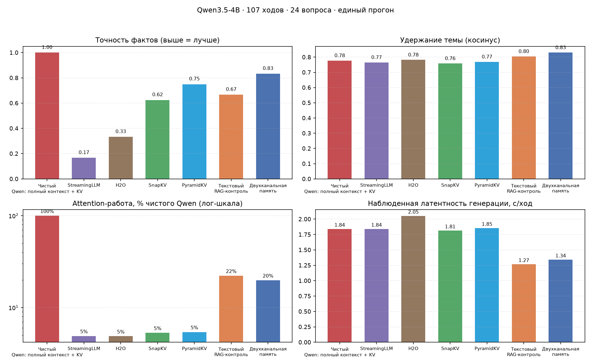

# Чистое сравнение памяти и KV-кэша на Qwen3.5-4B

## Результат

Чистый Qwen3.5-4B с полным контекстом ответил верно на 24/24 контрольных вопросов. Двухканальная система получила recall 0.833 при 5.04× меньшей прокси-работе attention. Наблюденная средняя латентность генерации — 1.84 с у чистого Qwen и 1.34 с у двухканальной системы. Это результат одного полного прогона, а не доказанное устойчивое ускорение.

## Качество

| Система | Recall | Прямые | Перефраз. | Тон | Stale | Повторы |
|---|---|---|---|---|---|---|
| Чистый Qwen: полный контекст + KV | 1.000 | 1.000 | 1.000 | 0.777 | 0.125 | 0.000 |
| StreamingLLM | 0.167 | 0.167 | 0.167 | 0.765 | 0.000 | 0.000 |
| H2O | 0.333 | 0.333 | 0.333 | 0.782 | 0.083 | 0.000 |
| SnapKV | 0.625 | 0.583 | 0.667 | 0.758 | 0.042 | 0.001 |
| PyramidKV | 0.750 | 0.833 | 0.667 | 0.769 | 0.083 | 0.000 |
| Текстовый RAG-контроль | 0.667 | 0.750 | 0.583 | 0.805 | 0.083 | 0.000 |
| Двухканальная память | 0.833 | 0.750 | 0.917 | 0.830 | 0.083 | 0.000 |

## Стоимость

| Система | Prompt | Генер. | Embed | Attn-слоты | Экономия | Mean, с | Median, с | P90, с | Max KV | Peak MiB |
|---|---|---|---|---|---|---|---|---|---|---|
| Чистый Qwen: полный контекст + KV | 276,970 | 3,341 | 4,571 | 8,559,983 | 1.00× | 1.84 | 1.79 | 2.53 | 5015 | 12368 |
| StreamingLLM | 276,347 | 3,310 | 4,537 | 420,096 | 20.38× | 1.84 | 1.79 | 2.52 | 128 | 12316 |
| H2O | 276,423 | 3,290 | 4,517 | 417,536 | 20.50× | 2.05 | 2.06 | 2.61 | 128 | 8303 |
| SnapKV | 275,339 | 3,215 | 4,434 | 455,281 | 18.80× | 1.81 | 1.80 | 2.41 | 159 | 12075 |
| PyramidKV | 275,864 | 3,285 | 4,505 | 464,068 | 18.45× | 1.85 | 1.84 | 2.42 | 279 | 12252 |
| Текстовый RAG-контроль | 57,897 | 3,419 | 4,651 | 1,902,861 | 4.50× | 1.27 | 1.28 | 1.29 | 626 | 8343 |
| Двухканальная память | 55,767 | 3,096 | 4,310 | 1,698,815 | 5.04× | 1.34 | 1.49 | 1.52 | 635 | 8356 |



## Протокол

- Одна модель Qwen/Qwen3.5-4B, bf16, AMD GPU, greedy-декодирование, до 32 новых токенов, seed=0.
- Диалог из 107 ходов: 16 фактов, 2 смены фактов и 24 вопроса; 12 прямых и 12 переформулированных.
- StreamingLLM, H2O, SnapKV и PyramidKV реализованы в проекте по статьям, а не взяты из официальных репозиториев. Для KV-методов средний бюджет — 128 слотов на full-attention слой; StreamingLLM хранит 4 sink + 124 recent, H2O — 4 sink + 64 recent + до 60 heavy hitters.
- Текстовый RAG-контроль — буфер 5 ходов и обычная семантическая выдача текстовых заметок без центроида, скрытых тем и attention-инъекции. Это MemGPT-подобный контроль, но не полный MemGPT.
- Двухканальная система добавляет к текстовому retrieval латентный канал: активации скрытых слоёв извлекаются по косинусной близости, проецируются в дополнительные K/V и подключаются к четырём средним full-attention слоям без преобразования в текст.
- Memorizing Transformer, RMT, Landmark Attention и Memory Layers требуют специального обучения или архитектуры; они остаются в обзоре литературы и не получают выдуманных чисел в этой батарее.

## Ограничения

- Recall — keyword-скоринг; тон — косинусная близость ответа к репликам диалога, а не независимая человеческая оценка.
- Stale показывает любое упоминание прежнего значения. Ответ может одновременно назвать новое верное значение и старое как прежнее; такой ответ не обязательно фактически ошибочен. Знаменатель stale — все 24 вопроса.
- Attention-слоты — сумма средних длин KV-кэша по шагам генерации, сопоставимый прокси работы, но не прямой замер FLOPs.
- Латентность включает prefill и decoding, но не внешние embedding/retrieval. Peak MiB относится к вызовам генерации. Один прогон без interleaved-повторов не поддерживает сильных выводов о скорости.
- n=24, один seed: различия в один вопрос равны 0.042 recall; статистическая значимость не оценивалась.

## Источники методов

- StreamingLLM: https://arxiv.org/abs/2309.17453
- H2O: https://arxiv.org/abs/2306.14048
- SnapKV: https://arxiv.org/abs/2404.14469
- PyramidKV: https://arxiv.org/abs/2406.02069
- MemGPT (только концептуальный ориентир): https://arxiv.org/abs/2310.08560

## Воспроизведение

```bash
HF_HUB_OFFLINE=1 .venv/bin/python -m tmem.cli --model unused --battery100 --models qwen35-4b --device cuda --dtype bfloat16 --max-new-tokens 32 --strategies classic_kv_full sparse_sliding_128 sparse_topk_128 snapkv_128 pyramidkv_128 rag_text_only v4_rag_kv --out results/qwen35_comparison
.venv/bin/python scripts/build_report.py
.venv/bin/python scripts/build_paper.py
```
