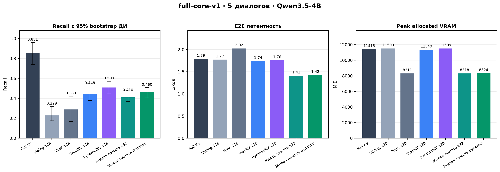
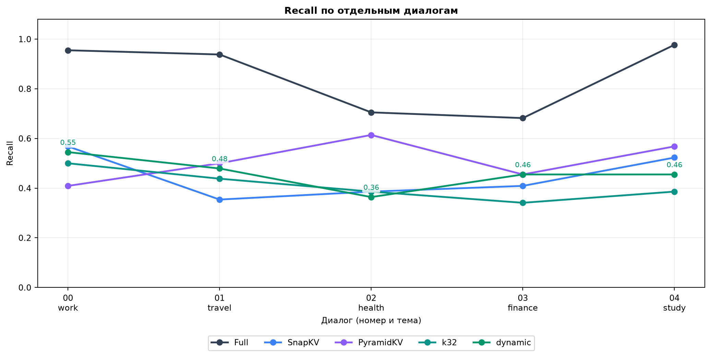
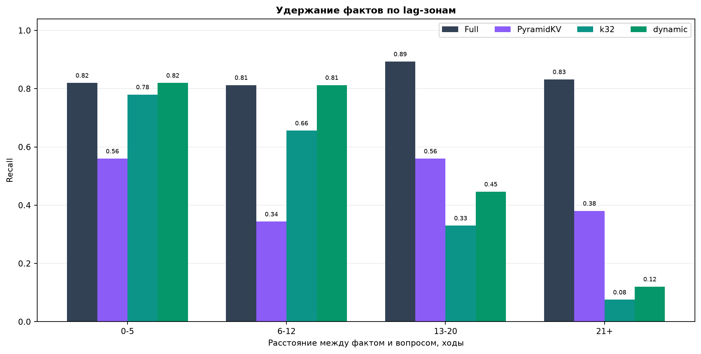

# Full-core-v1: актуальный отчёт

**Срез:** 5/48 диалогов · Qwen3.5-4B bf16 · 100 ходов на диалог · 2026-11-19.

## Краткий вывод

Динамическая живая память получила recall **0.460** против **0.410** у фиксированного k32; paired bootstrap с поправкой Холма: **p=0.027**. PyramidKV имеет **0.509**, Full KV — **0.851**. Разница dynamic с PyramidKV не значима (p=0.866), но при n=5 это не доказывает паритет.

Относительно PyramidKV dynamic быстрее на **18.9%**, использует на **27.7%** меньше peak allocated VRAM и в **4.96 раза** меньше prompt-токенов. Гейт подключает **2.52** слота/шаг против **31.92** у k32 — сокращение в **12.7 раза**.

## Качество и стоимость



| Стратегия | Recall [95% ДИ] | Answerable recall | E2E, с/ход | Peak VRAM, MiB | Prompt-токены | Attention-слоты |
|---|---:|---:|---:|---:|---:|---:|
| Full KV | 0.851 [0.741, 0.961] | 0.836 | 1.787 | 11415 | 218052 | 6716187 |
| Sliding 128 | 0.229 [0.176, 0.320] | 0.153 | 1.775 | 11509 | 220435 | 396793 |
| TopK 128 | 0.289 [0.169, 0.423] | 0.220 | 2.025 | 8311 | 222188 | 400607 |
| SnapKV 128 | 0.448 [0.378, 0.525] | 0.394 | 1.740 | 11349 | 218397 | 435907 |
| PyramidKV 128 | 0.509 [0.446, 0.573] | 0.461 | 1.758 | 11509 | 221525 | 444305 |
| Живая память k32 | 0.410 [0.368, 0.454] | 0.352 | 1.411 | 8318 | 44621 | 1450572 |
| Живая память dynamic | 0.460 [0.405, 0.509] | 0.406 | 1.425 | 8324 | 44623 | 1446897 |

E2E — медиана диалоговых медиан пяти повторов после warmup. Peak VRAM — среднее по диалогам `torch.max_memory_allocated`, не reserved-память всего процесса. Answerable recall исключает unanswerable-пробы.

## Парные сравнения dynamic

| Сравнение | Разница recall | p после Холма |
|---|---:|---:|
| dynamic vs Живая память k32 | +0.049 | 0.0270 |
| dynamic vs PyramidKV 128 | -0.050 | 0.8660 |
| dynamic vs SnapKV 128 | +0.012 | 0.8660 |

Проверки выполнены парным bootstrap по диалогам; три ключевых p-value скорректированы методом Холма.

## Разбор по диалогам



| Диалог | Full | SnapKV | PyramidKV | k32 | dynamic |
|---|---:|---:|---:|---:|---:|
| main-L100-00-work-terse-baseline | 0.955 | 0.568 | 0.409 | 0.500 | 0.545 |
| main-L100-01-travel-chatty-updates | 0.938 | 0.354 | 0.500 | 0.438 | 0.479 |
| main-L100-02-health-sloppy-adversarial | 0.705 | 0.386 | 0.614 | 0.386 | 0.364 |
| main-L100-03-finance-formal-distractors | 0.682 | 0.409 | 0.455 | 0.341 | 0.455 |
| main-L100-04-study-terse-multifact | 0.977 | 0.523 | 0.568 | 0.386 | 0.455 |

## Дистанция удержания



| Стратегия | 0–5 | 6–12 | 13–20 | 21+ |
|---|---:|---:|---:|---:|
| Full KV | 0.820 | 0.812 | 0.893 | 0.832 |
| SnapKV 128 | 0.640 | 0.312 | 0.570 | 0.199 |
| PyramidKV 128 | 0.560 | 0.344 | 0.560 | 0.381 |
| Живая память k32 | 0.780 | 0.656 | 0.330 | 0.076 |
| Живая память dynamic | 0.820 | 0.812 | 0.447 | 0.121 |

Dynamic улучшает дальние зоны относительно k32, но temporal recall остаётся 0.000. Поэтому результат нельзя интерпретировать как решённую долгосрочную память.

## Метод и ограничения

Сравниваются Full KV, Sliding/TopK/SnapKV/PyramidKV с бюджетом 128 и два варианта живой K/V-памяти без текстового RAG. Dynamic отбирает до 32 векторов с косинусом не ниже 0.5. Recall — keyword-скоринг синтетических проб, а не человеческая оценка. Выборка мала и пока охватывает только 100-ходовые диалоги; разные темы и сценарии представлены неравномерно. Незначимый результат при n=5 не является доказательством отсутствия эффекта.

## Воспроизведение

```bash
.venv/bin/python scripts/build_core_report.py
```

Источник: `results/corpus/full-core-v1/batches/`.
