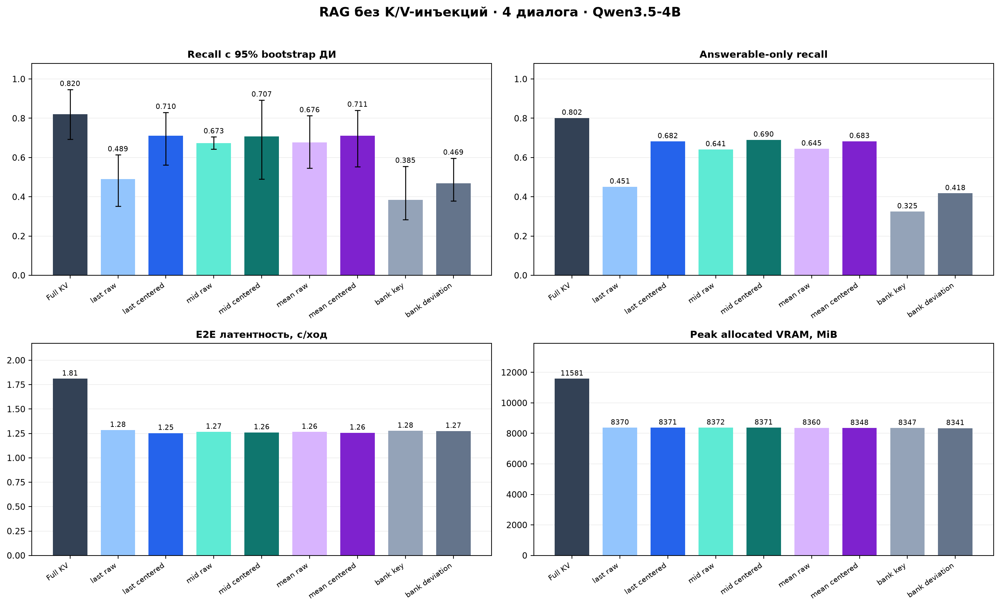
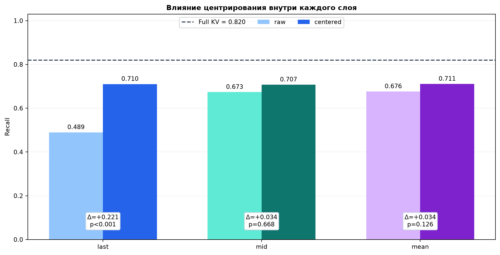
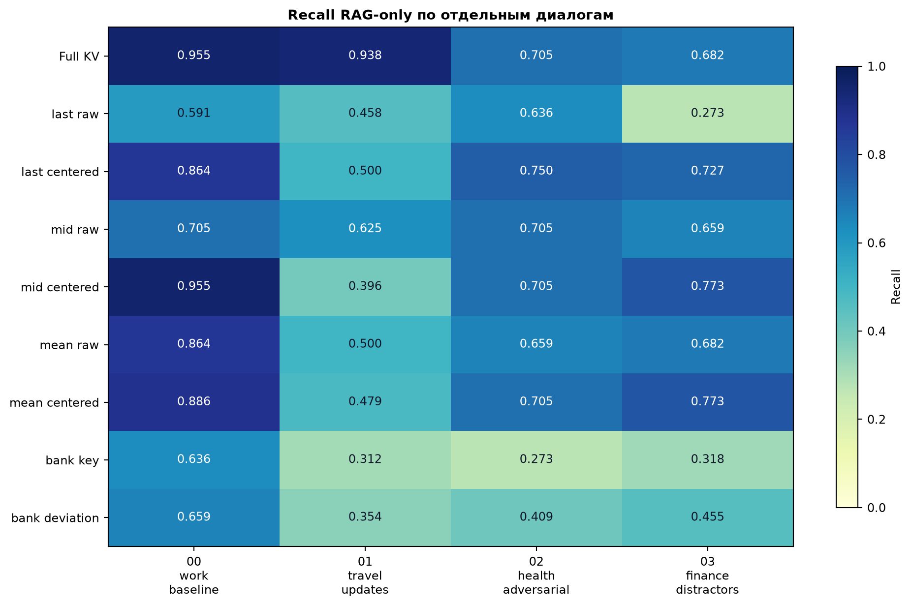
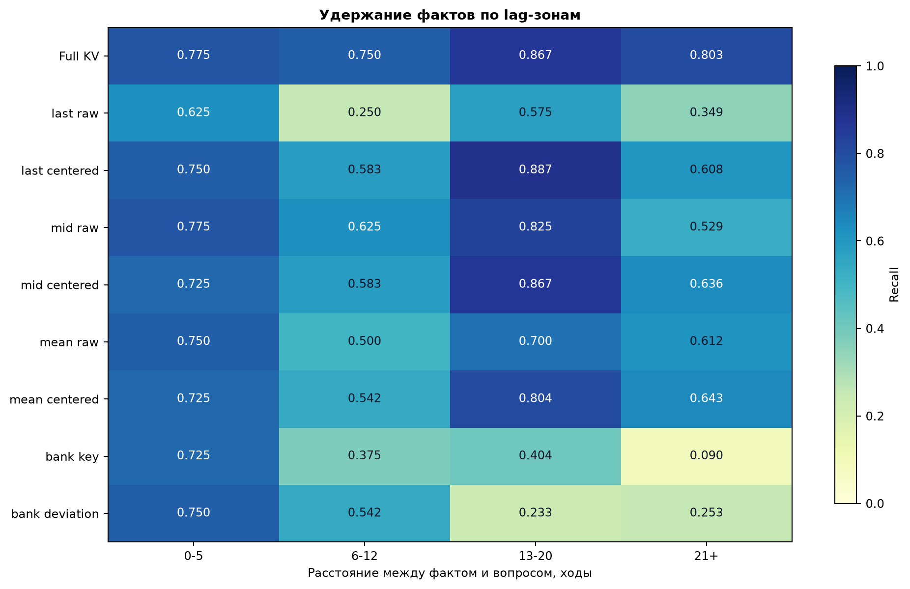

# Full-rag-v1: RAG без K/V-инъекций

**Срез:** 4/48 диалогов · Qwen3.5-4B bf16 · 2026-11-20. Все стратегии `v4_rag_kv_*` исключены.

## Краткий вывод

Лучшие utterance-keyed RAG образуют плотную группу: mean centered **0.711**, last centered **0.710**, mid centered **0.707**. При n=4 нет оснований объявлять один из них однозначным победителем. Full KV сохраняет преимущество: **0.820**.

Центрирование last улучшает recall с 0.489 до 0.710 (**Δ=+0.221**, p<0.001) и помогает на каждом из четырёх диалогов. Для mid и mean средние приросты малы и не значимы. Bank-keyed варианты заметно отстают.

## Качество и стоимость



| Стратегия | Recall [95% ДИ] | Answerable | E2E, с/ход | Peak VRAM, MiB | Prompt-токены |
|---|---:|---:|---:|---:|---:|
| Full KV | 0.820 [0.694, 0.947] | 0.802 | 1.810 | 11581 | 223115 |
| last raw | 0.489 [0.352, 0.614] | 0.451 | 1.285 | 8370 | 50011 |
| last centered | 0.710 [0.562, 0.830] | 0.682 | 1.254 | 8371 | 49673 |
| mid raw | 0.673 [0.642, 0.705] | 0.641 | 1.266 | 8372 | 49848 |
| mid centered | 0.707 [0.490, 0.892] | 0.690 | 1.261 | 8371 | 49466 |
| mean raw | 0.676 [0.545, 0.813] | 0.645 | 1.265 | 8360 | 49540 |
| mean centered | 0.711 [0.552, 0.841] | 0.683 | 1.257 | 8348 | 49610 |
| bank key | 0.385 [0.284, 0.555] | 0.325 | 1.276 | 8347 | 48145 |
| bank deviation | 0.469 [0.379, 0.597] | 0.418 | 1.275 | 8341 | 49335 |

E2E — медиана диалоговых медиан пяти повторов после warmup. Answerable исключает unanswerable-пробы. Peak VRAM — среднее `torch.max_memory_allocated`, не reserved-память.

## Слой и центрирование



| Слой | Raw | Centered | Δ centered−raw | p после Холма |
|---|---:|---:|---:|---:|
| last | 0.489 | 0.710 | +0.221 | <0.001 |
| mid | 0.673 | 0.707 | +0.034 | 0.668 |
| mean | 0.676 | 0.711 | +0.034 | 0.126 |

Парный bootstrap выполнен по диалогам; три проверки центрирования скорректированы методом Холма. У last все четыре парных сдвига положительны. Для mid/mean направление меняется между диалогами или эффект мал.

## Значения по диалогам



## Дистанция удержания



Centered-варианты лучше удерживают дальние факты, но остаются ниже Full KV. Bank deviation особенно слаб в зонах 13–20 и 21+.

## Метод и ограничения

last — финальный слой, mid — один средний слой, mean — среднее всех слоёв. Raw использует исходный эмбеддинг; centered вычитает running mean текстового RAG-банка. Bank key/deviation используют слоты живого банка только как retrieval-ключи, без K/V-инъекции.

Готово только 4 диалога, все длиной 100 ходов; тема, персона и сценарий изменяются вместе. Recall является keyword-скорингом синтетических проб. Доверительные интервалы широкие, поэтому небольшие различия между лучшими centered-вариантами не следует переинтерпретировать.

## Воспроизведение

```bash
.venv/bin/python scripts/build_rag_only_report.py
```

Источник: `results/corpus/full-rag-v1/batches/`.
