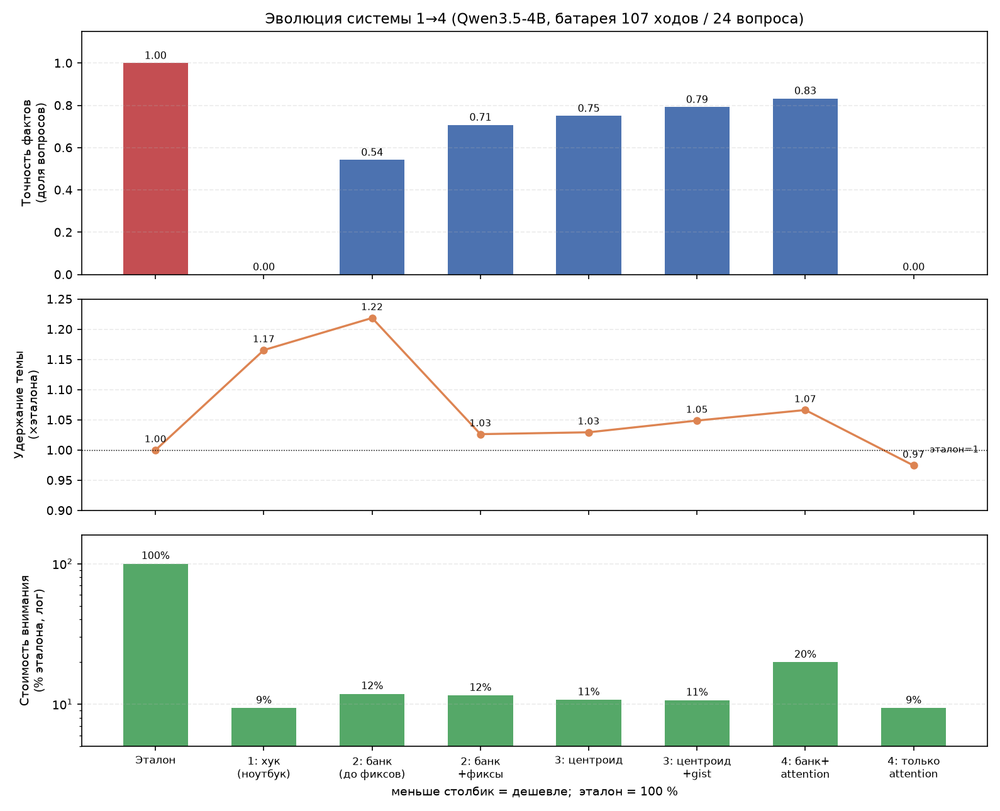
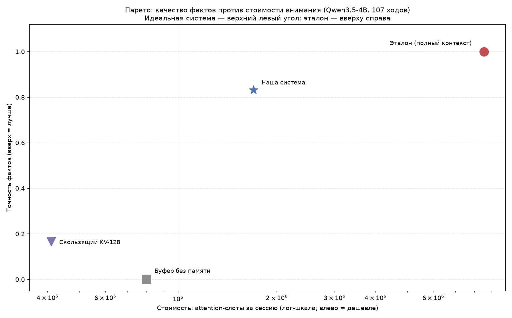
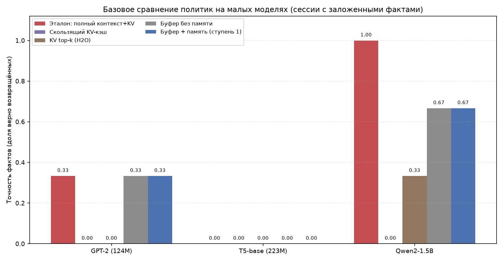
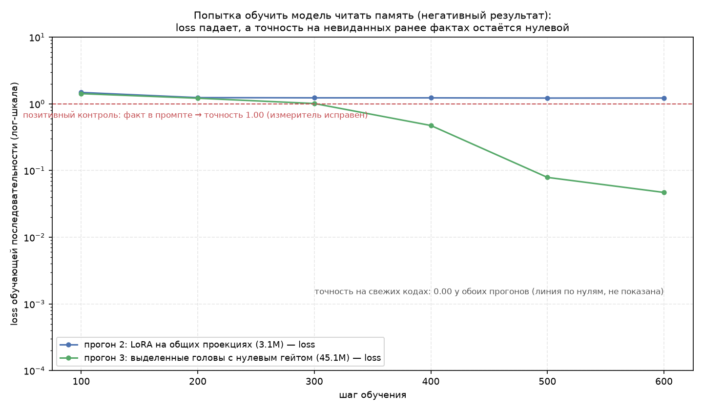

# Смысловая память для диалогового LLM — полный отчёт (ступени 1–4)

_Qwen3.5-4B / Qwen2-1.5B / GPT-2 / T5-base · AMD RX 7900 XT (ROCm 6.3) · октябрь 2026 · код и данные: проект `tmem`_

## Методика
- Модели: Qwen2-1.5B, GPT-2, T5-base (базовые прогоны) и Qwen3.5-4B (основная батарея: гибридная архитектура — 24 слоя линейного внимания Gated DeltaNet + 8 слоёв обычного внимания).
- Сессии: программируемые диалоги 35–107 ходов; 9–16 фактов закладываются в начале/середине/конце, 2–3 факта по ходу меняются, 8–24 контрольных вопроса (каждый второй — переформулированный) задаются далеко от факта (задержка 30–88 ходов).
- Протокол: greedy-генерация, 24–32 токена ответа, seed=0; единый явный цикл декодирования с ручным управлением KV-кэшем (корректность классического кэша доказана тестом «с кэшем == без кэша, токен-в-токен», включая настоящего GPT-2).
- Оборудование: AMD Radeon RX 7900 XT (20 GiB), PyTorch 2.9.1+ROCm 6.3, bf16 (Qwen3.5) / fp32 (остальные).
- Программный стек: пакет tmem (память, хуки, политики кэша, банк фактов, батареи), 139 офлайн-тестов + integration + gpu.

## Глоссарий метрик
| Метрика | Значение |
|---|---|
| Точность фактов (recall) | доля контрольных вопросов, в ответе на которые модель назвала верное заложенное значение (поиск эталонных слов в ответе) |
| Удержание темы (tone, ×эталона) | косинусная близость ответа к высказываниям этого же диалога, нормированная на значение эталона (1.00 = как полный контекст) |
| Устаревшие ответы (stale) | доля вопросов, где после смены факта модель вернула прежнее значение (меньше — лучше) |
| Деградация (repetition) | доля ответов с повторяющимися слово-трёхграммами («I I I…» и т.п.) |
| Prompt-токены | суммарные токены, поданные на вход за всю сессию |
| attention-работа (слоты) | Σ по шагам длины KV-кэша; пропорциональна FLOPs внимания — главный показатель стоимости |
| ×дешевле эталона | отношение attention-работы эталона к конфигурации |
| Латентность | среднее время одного хода диалога, секунды |

## Основная таблица: Qwen3.5-4B, батарея 107 ходов / 24 вопроса
| Конфигурация | Факты↑ | Тема ×эт. | Устар.↓ | Деград.↓ | Prompt ток. | Attn слоты | ×дешевле | Лат. с/ход |
|---|---|---|---|---|---|---|---|---|
| Эталон: весь диалог в контексте + классический KV-кэш | 1.00 | 1.00× | 0.12 | 0.00 | 276,970 | 8,559,983 | 1.0× | 1.87 |
| Разреженный KV-кэш: скользящее окно (128 слотов) | 0.17 | 1.17× | 0.00 | 0.00 | 275,063 | 410,752 | 20.8× | 1.92 |
| Буфер 2 хода, никакой памяти | 0.00 | 1.15× | 0.00 | 0.00 | 23,383 | 801,328 | 10.7× | 1.17 |
| Буфер 5 ходов, никакой памяти | 0.00 | 1.20× | 0.00 | 0.00 | 51,964 | 1,715,920 | 5.0× | 1.26 |
| Ступень 1 — темы+аддитивный хук (как в ноутбуке) | 0.00 | 1.17× | 0.00 | 0.00 | 23,391 | 801,584 | 10.7× | 1.71 |
| Ступень 1' — EMA-слияние .95/k.25 (чинит банк тем) | 0.00 | 1.18× | 0.00 | 0.00 | 23,371 | 800,711 | 10.7× | 1.66 |
| Ступень 2 — банк фактов текстом (до фиксов) | 0.54 | 1.22× | 0.08 | 0.00 | 30,860 | 1,013,837 | 8.4× | 1.21 |
| Ступень 2+ — банк текстом (после фиксов) | 0.71 | 1.03× | 0.08 | 0.00 | 29,312 | 986,331 | 8.7× | 1.17 |
| Ступень 2+gist — банк + темы для выдачи | 0.67 | 1.04× | 0.08 | 0.00 | 28,889 | 949,147 | 9.0× | 1.67 |
| Ступень 3 — банк с центрированием по теме | 0.75 | 1.03× | 0.12 | 0.00 | 28,827 | 917,674 | 9.3× | 1.11 |
| Ступень 3 — центроид + темы из ступени 1 | 0.79 | 1.05× | 0.04 | 0.00 | 28,740 | 911,812 | 9.4× | 2.30 |
| Ступень 3 — центроид, буфер 5 | 0.71 | 1.04× | 0.12 | 0.00 | 57,187 | 1,801,193 | 4.8× | 1.21 |
| Ступень 4 — память только в attention (без текста) | 0.00 | 0.97× | 0.00 | 0.00 | 23,395 | 801,712 | 10.7× | 1.40 |
| Ступень 4 — банк + память в attention (финальная) | 0.83 | 1.07× | 0.08 | 0.00 | 55,767 | 1,698,815 | 5.0× | 1.34 |

_Прим.: «Тема ×эт.» нормирована на эталон внутри своей измерительной серии; строки ранних серий («до фиксов», ступень 1, политики KV) сравниваются по этой колонке только внутри группы. Выводы опираются на серии «+фиксы», ступени 3–4 (общая шкала)._

## Ступени системы
| Ступень | Идея |
|---|---|
| Эталон и политики кэша | Полный контекст с классическим KV-кэшем — верхняя планка качества; пересчёт без кэша — проверка корректности; скользящий и top-k(H2O) KV-кэши — «дешёвое внимание» из литературы. |
| Ступень 1 — скрытые темы (как в ноутбуке) | Банк слотов из скрытых состояний токенов: косинус-выдача, TTL, слияние sim≥0.8 усреднением; инжекция средним вектором в активации. Идея: состояние диалога вместо истории. |
| Ступень 1' — починка слияния | EMA-слияние a←(1−k)a+k·b и порог 0.95: банк перестает схлопываться (51→99 отдельных фактов), но аддитивная инжекция всё ещё не читается моделью. |
| Ступень 2 — банк фактов текстом (RAG) | Факты хранятся текстом, эмбеддинг = mean-pool последних скрытых состояний самой модели; релевантные заметки попадают в промпт. Две фикс-итерации: вопросы не перетирают факты; в банк пишутся только декларации (не пересказы-ответы). |
| Ступень 3 — центроид темы | Хранение и сравнение ОТКЛОНЕНИЙ от бегущего среднего банка: тема диалога становится системой координат бесплатно (без хуков), анизотропия эмбеддингов вычитается, upsert перестаёт поедать банк. |
| Ступень 4 — память в attention | Исходный замысел: активные темы входят в средние full-attention слои как дополнительные ключи/значения без позиции, с расширением маски; в кэш не пишутся. GPU-стоимость канала ≈ 0 (32 ключа из 3000). |
| Обучение читателя (эксперимент) | LoRA на общих проекциях и отдельный считывающий путь с нулевым гейтом — учим модель читать факты из канала памяти, а не только тон. |

## Графики





## Базовое сравнение политик на малых моделях
| Модель: политика | Факты | Prompt токены | Attn слоты | Лат. с/ход |
|---|---|---|---|---|
| GPT-2: классический KV | 0.33 | 2,090 | 52,920 | 0.126 |
| GPT-2: скользящий KV | 0.00 | 2,090 | 27,296 | 0.146 |
| GPT-2: KV top-k H2O | 0.00 | 2,090 | 27,296 | 0.154 |
| GPT-2: буфер | 0.33 | 1,825 | 46,560 | 0.124 |
| GPT-2: буфер+память(стр.1) | 0.33 | 1,825 | 46,560 | 0.365 |
| T5-base: классический KV | 0.00 | 1,903 | 2,703 | 0.133 |
| T5-base: скользящий KV | 0.00 | 1,903 | 2,703 | 0.184 |
| T5-base: KV top-k H2O | 0.00 | 1,903 | 2,703 | 0.251 |
| T5-base: буфер | 0.00 | 1,692 | 2,703 | 0.261 |
| T5-base: буфер+память(стр.1) | 0.00 | 1,546 | 2,406 | 0.612 |
| Qwen2-1.5B: классический KV | 1.00 | 2,003 | 36,354 | 0.783 |
| Qwen2-1.5B: скользящий KV | 0.00 | 2,002 | 21,039 | 0.834 |
| Qwen2-1.5B: KV top-k H2O | 0.33 | 2,002 | 21,167 | 0.882 |
| Qwen2-1.5B: буфер | 0.67 | 1,739 | 33,657 | 0.786 |
| Qwen2-1.5B: буфер+память(стр.1) | 0.67 | 1,696 | 34,332 | 1.142 |

## Воспроизведение
```bash
.venv/bin/python -m pytest -q              # 139 офлайн-тестов
.venv/bin/python -m pytest -m gpu -q        # проверки на видеокарте
.venv/bin/python -m tmem.cli --model qwen2-1.5b --device cuda   # базовое сравнение
.venv/bin/python -m tmem.cli --model unused --stress --models gpt2 t5-base qwen2-1.5b --device cuda
.venv/bin/python -m tmem.cli --model unused --battery100 --models qwen35-4b --device cuda --dtype bfloat16
.venv/bin/python -m tmem.trainreader --steps 600
```