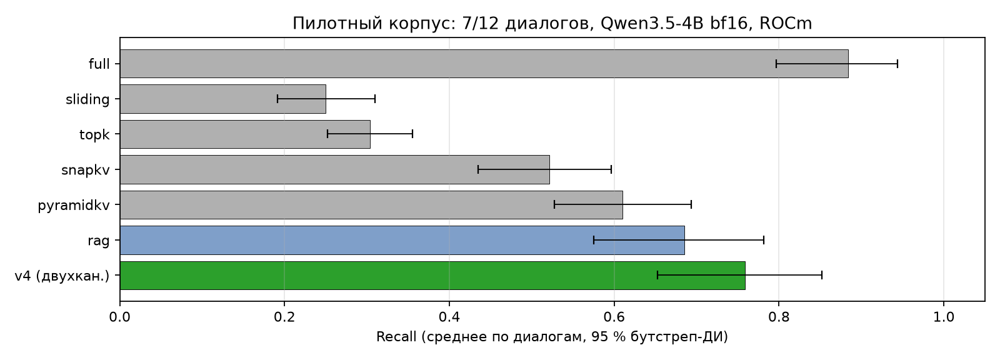
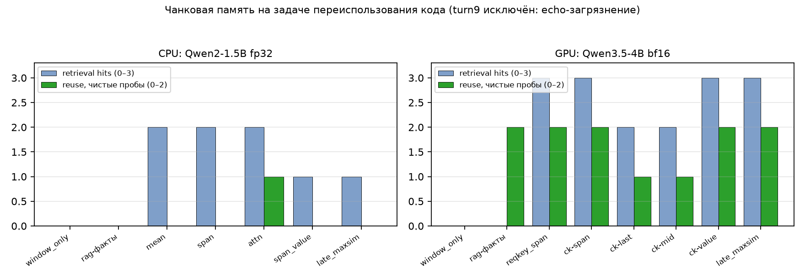

# Ночной прогон и вариации архитектуры чанковой памяти

Дата: 14.11.2026 · модель корпуса: Qwen3.5-4B bf16 (ROCm, RX 7900 XTX) · git d1e52f6 · данные на 14.11.2026 12:02

## Резюме

- Ночной пилот (7/12 диалогов, 13.7 ч GPU, 0 падений): порядки recall из статьи воспроизведены — v4 0.759 > rag 0.685 > pyramidkv 0.610 > snapkv 0.521 > sliding/topk.
- v4 значимо лучше snapkv (p = 0.026) и sliding (p < 0.001); против rag и pyramidkv различия пока не значимы (n = 7).
- Цена: v4 — медиана 1.36 с/ход против 1.79 с у полного контекста; промпт 49835 против 223333 токенов (в 4.5 раза меньше).
- Вариации архитектуры чанковой памяти: контентный ключ (активации блока, среднее по слоям) + центрирование бегущим средним даёт 3/3 поиска и 3/3 переиспользования кода на 4B; ключ из одного слоя хуже (2/3). Без памяти модель галлюцинирует имена функций.
- Банк фактов пользователя вспоминает имена функций из запросов, но не сам код (0/3 code-hits); чанковый банк возвращает реализации.

## 1. Протокол ночного прогона

- Модель qwen35-4b (Qwen/Qwen3.5-4B), bfloat16, AMD RX 7900 XTX 24 ГБ, torch 2.9.1+rocm6.3 (ROCm), git d1e52f6. Декодирование greedy, seed 0, max_new_tokens 32.
- Корпус pilot: синтетические диалоги по 100 ходов, 6 тем × 4 персоны × 5 ситуаций, пробы во всех lag-зонах (direct/paraphrase/multihop/temporal/unanswerable). Батч = 1 диалог × 7 стратегий; очередь сбалансирована round-robin.
- Латентность: 1 warmup + 5 чередующихся повторов (A,B,A,B,…), end-to-end включая embedding/retrieval; порядок стратегий ротируется между батчами.
- Статистика: бутстреп-ДИ по диалогам (не по вопросам), попарный бутстреп с поправкой Холма. То же ядро, что в INTERIM.md и финальной агрегации.
- Окно прогона: 13.11 22:12 — 14.11 12:00. Батчи: 7 выполнено, wall-time 114–121 мин, падений 0, перезапусков 0. Остановка/возобновление по манифесту проверены на практике.

## 2. Результаты пилота

| Стратегия | n | Recall [95 % ДИ] | direct | paraphr. | multihop | temporal | unansw. | e2e, с | prompt токены |
|---|---|---|---|---|---|---|---|---|---|
| classic_kv_full | 7 | 0.884 [0.797; 0.944] | 0.871 | 0.929 | 0.554 | 1.000 | 1.000 | 1.786 | 223333 |
| sparse_sliding_128 | 7 | 0.250 [0.192; 0.309] | 0.239 | 0.286 | 0.089 | 0.000 | 1.000 | 1.786 | 227005 |
| sparse_topk_128 | 7 | 0.304 [0.252; 0.355] | 0.299 | 0.321 | 0.125 | 0.500 | 1.000 | 1.983 | 225794 |
| snapkv_128 | 7 | 0.521 [0.435; 0.597] | 0.536 | 0.464 | 0.250 | 0.250 | 1.000 | 1.725 | 223798 |
| pyramidkv_128 | 7 | 0.610 [0.528; 0.694] | 0.630 | 0.536 | 0.232 | 0.500 | 1.000 | 1.749 | 224736 |
| rag_text_only | 7 | 0.685 [0.575; 0.782] | 0.677 | 0.714 | 0.393 | 0.500 | 1.000 | 1.228 | 50012 |
| v4_rag_kv | 7 | 0.759 [0.653; 0.852] | 0.760 | 0.750 | 0.554 | 0.750 | 1.000 | 1.36 | 49835 |



### Recall по lag-зонам

| Стратегия | 0-5 | 6-12 | 13-20 | 21+ |
|---|---|---|---|---|
| classic_kv_full | 0.879 | 0.905 | 0.917 | 0.857 |
| sparse_sliding_128 | 0.379 | 0.048 | 0.083 | 0.064 |
| sparse_topk_128 | 0.364 | 0.405 | 0.083 | 0.129 |
| snapkv_128 | 0.679 | 0.488 | 0.583 | 0.330 |
| pyramidkv_128 | 0.618 | 0.762 | 0.639 | 0.494 |
| rag_text_only | 0.825 | 0.929 | 0.722 | 0.481 |
| v4_rag_kv | 0.886 | 0.917 | 0.805 | 0.592 |

### Попарные сравнения (paired bootstrap, поправка Холма)

- v4_rag_kv vs classic_kv_full: p = 0.1635
- v4_rag_kv vs pyramidkv_128: p = 0.1810
- v4_rag_kv vs rag_text_only: p = 0.1810
- v4_rag_kv vs snapkv_128: p = 0.0260
- v4_rag_kv vs sparse_sliding_128: p = 0.0000
- v4_rag_kv vs sparse_topk_128: p = 0.0000

## 3. Вариации архитектуры чанковой памяти

Идея: хранить не факты пользователя, а чанки собственной генерации. Ключ = активации слоёв самого блока (как hidden states в чат-версии), значение = контекстуализированный чанк (пул по токенам чанка в контексте породившего промпта), центрирование бегущим средним с обеих сторон. Поиск по сходству вытаскивает нужный кусок генерации, а не всю генерацию (один запрос может породить тысячи строк).

- Задача: модель пишет 3 функции (factorial, reverse_string, count_vowels), затем 5 filler-ходов, затем 3 пробы «напиши новую функцию, переиспользуя ранее написанную». Окно контекста = 2 пары: ранний код выпадает из контекста, вернуть его может только память.
- Метрики: reuse — имя нужной функции в ответе (keyword); retrieval hit — банк положил правильный код в промпт. Проба turn9 загрязнён (имя функции в самом вопросе, echo), чистые — turn8/turn10.
- Оси вариаций: ключ (запрос vs активации блока: mean/mid/last слоёв); эмбеддинг значения (mean/span/attn/late); скоринг (key/value/maxsim); центрирование бегущим средним ключей и значений.
- CPU: Qwen2-1.5B fp32, 8 потоков; GPU: Qwen3.5-4B bf16, ROCm. Greedy, max_new_tokens 64, одна сессия.

### CPU (Qwen2-1.5B)

| Стратегия | Reuse (все 3) | turn8 | turn10 | Hits | Латентность хода, с | embed токены |
|---|---|---|---|---|---|---|
| window_only | 0.333 | 0.000 | 0.000 | 0/3 | 17.7808 | 900 |
| window_rag_userfacts | 0.333 | 0.000 | 0.000 | 0/3 | 17.7709 | 899 |
| chunks_mean | 0.333 | 0.000 | 0.000 | 2/3 | 18.2943 | 1599 |
| chunks_span | 0.333 | 0.000 | 0.000 | 2/3 | 17.9429 | 11530 |
| chunks_attn | 0.667 | 1.000 | 0.000 | 2/3 | 18.2332 | 12537 |
| chunks_span_value | 0.333 | 0.000 | 0.000 | 1/3 | 18.1729 | 11618 |
| chunks_late_maxsim | 0.000 | 0.000 | 0.000 | 1/3 | 18.523 | 11357 |

### GPU (Qwen3.5-4B)

| Стратегия | Reuse (все 3) | turn8 | turn10 | Hits | Латентность хода, с | embed токены |
|---|---|---|---|---|---|---|
| window_only | 0.333 | 0.000 | 0.000 | 0/3 | 1.0012 | 490 |
| window_rag_userfacts | 1.000 | 1.000 | 1.000 | 0/3 | 0.9103 | 460 |
| chunks_reqkey_span | 1.000 | 1.000 | 1.000 | 3/3 | 0.9326 | 3856 |
| chunks_contentkey_span | 1.000 | 1.000 | 1.000 | 3/3 | 1.0402 | 4416 |
| chunks_contentkey_last | 0.667 | 0.000 | 1.000 | 2/3 | 1.3179 | 5938 |
| chunks_contentkey_mid | 0.667 | 1.000 | 0.000 | 2/3 | 0.889 | 3983 |
| chunks_contentkey_value | 1.000 | 1.000 | 1.000 | 3/3 | 1.0779 | 4464 |
| chunks_late_maxsim | 1.000 | 1.000 | 1.000 | 3/3 | 1.0359 | 4570 |



### Находки

- Контентный ключ работает: на 4B mean-по-слоям даёт 3/3 retrieval hits и 3/3 reuse — модель пишет реальные вызовы ранее созданных функций (return s == reverse_string(s); count_vowels(s)/len(s)).
- Абляция слоёв: mean (3/3) лучше last (2/3) и mid (2/3) — усреднение активаций по слоям важно.
- Без памяти (window_only) 4B галлюцинирует имена: reverse(s), vowel_count(s) вместо написанных reverse_string/count_vowels. Это целевой сбой, который закрывает чанковая память.
- RAG по фактам пользователя: reuse 1.0 при 0/3 code-hits — имена утекают из текстов запросов; вспоминаются имена, а не реализации.
- На CPU (1.5B) лучший reuse у attn-режима (0.667, единственный настоящий вызов на чистой пробе); value/maxsim-скоринг ищут хуже (1/3). На 4B все режимы поиска 3/3 — сильная модель компенсирует.
- Цена чанковой памяти на 4B: ~4.4 тыс. embed-токенов против ~0.5 тыс. у baseline (~9×), латентность хода +4 % (1.04 с против 1.00 с).

## 4. Ограничения

- Пилот не завершён (7/12): ДИ широкие, различия v4 против rag/pyramidkv могут стать значимыми после догона очереди; interim-числа не финальные.
- Recall — keyword-скоринг по синтетическому корпусу; full < 1.0 из-за сложности multihop-проб (0.554 даже с полным контекстом), а не из-за отказа памяти.
- Оценка чанковой памяти — одна короткая сессия (3 функции), n=1, greedy: проверка механики, не статистика. Случай «тысячи строк на один запрос» не покрыт — нужен стресс-тест длинной генерации.
- Латентность корпуса — end-to-end на одной машине без interleaved-повторов между сессиями; сравнение стратегий внутри батча честное (чередование), абсолютные числа переносить осторожно.
- causal_conv1d не установлен (референсный kernel), flash-attention на AMD не включён — абсолютная латентность занижена относительно оптимизированной сборки; сравнение стратегий не искажено.

## 5. Выводы и следующие шаги

- Догнать пилот (5 диалогов ≈ 9.8 ч GPU) и пройти ГК-2; затем основная очередь main (48 батчей).
- Стресс-тест контентного ключа: длинная генерация (десятки функций в одном ответе) — проверка, что вспоминается нужный кусок, а не вся генерация.
- Черновик фрагмента для статьи готов (results/corpus/PAPER_FRAGMENT.md); вставка после завершения основной очереди и просмотра заказчиком.

## Приложение. Воспроизведение

```bash
HF_HUB_OFFLINE=1 .venv/bin/python -m tmem.corpus_run --preset pilot --model qwen35-4b --dtype bfloat16 --batches 4 --run-id pilot-v1
HF_HUB_OFFLINE=1 .venv/bin/python scripts/chunk_code_eval.py      # CPU, 1.5B
HF_HUB_OFFLINE=1 .venv/bin/python scripts/chunk_code_eval_4b.py   # GPU, 4B
.venv/bin/python scripts/build_night_report.py                    # этот отчёт
```
