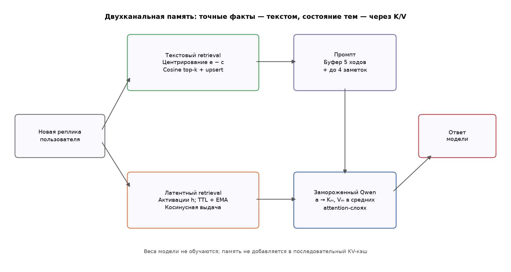
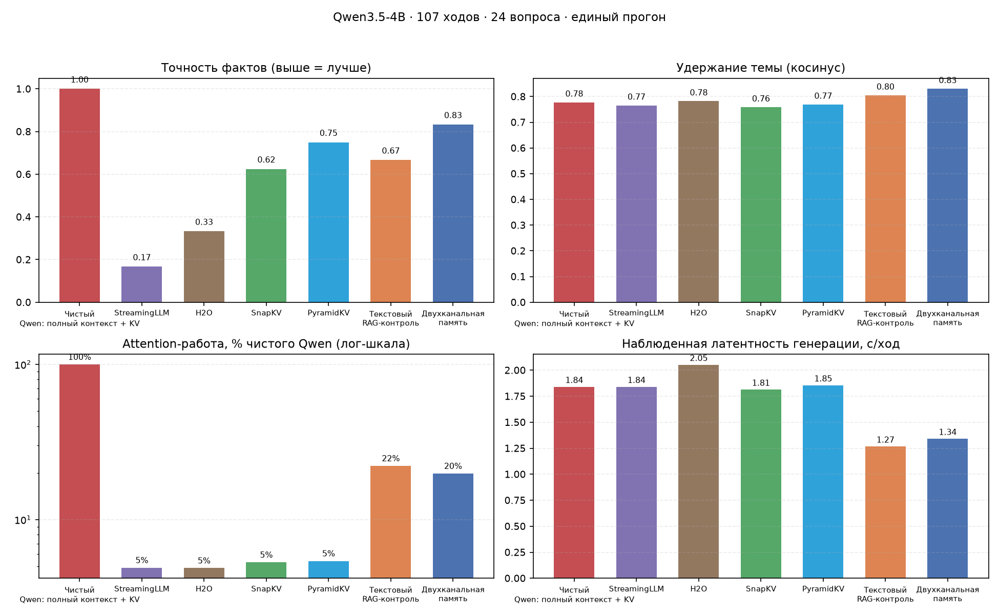
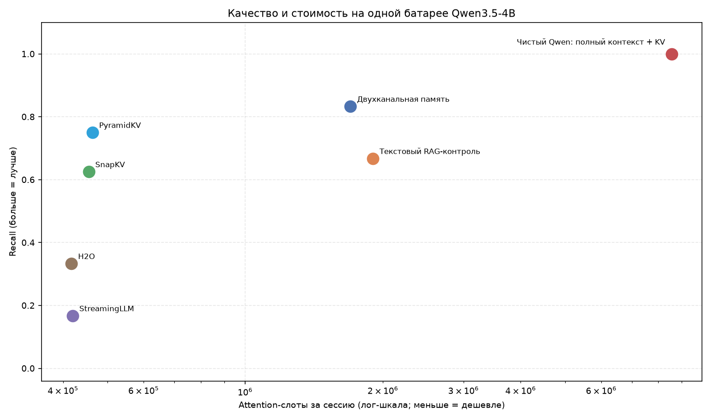

# Двухканальная память для диалогового LLM: текстовый retrieval и активации скрытых слоёв в attention

_Экспериментальное исследование · пакет tmem_

## Аннотация

Длинный диалог требует либо хранения полной истории, либо механизма, который сохраняет редкие факты в компактной форме. В работе исследуется двухканальная память для замороженной диалоговой модели. Первый канал выполняет текстовый retrieval: банк с центрированными эмбеддингами возвращает дословные факты в промпт. Второй канал реализует латентный retrieval: активации скрытых слоёв выбираются по косинусной близости и подключаются к средним full-attention слоям как дополнительные беспозиционные ключи и значения. Таким образом, предложенная система не сводится к текстовому RAG. Проведено контролируемое сравнение с полным контекстом, StreamingLLM, H2O, SnapKV, PyramidKV и отдельным текстовым RAG-контролем без латентного канала. Все системы используют одну модель Qwen3.5-4B, один диалог из 107 ходов, greedy-генерацию и единый набор метрик. Полный контекст возвращает 24/24 фактов. Предложенная система возвращает 20/24 (recall=0.833) и сокращает decode-side attention-прокси в 5.04 раза; средняя наблюденная латентность генерации составляет 1.34 с против 1.84 с у полного контекста. Среди KV-методов наилучший recall показывает PyramidKV (0.750). Результаты показывают компромисс между точностью и стоимостью, но не доказывают статистически устойчивое ускорение или независимый вклад отдельных компонентов: исследование ограничено одним диалогом и одним прогоном.

**Ключевые слова:** диалоговые LLM; долгосрочная память; латентный retrieval; attention-память; KV-кэш; Qwen3.5

## 1. Введение

Способность диалогового ассистента удерживать факты за пределами последних реплик необходима для персонализации, работы с проектами и продолжительного планирования. Наиболее простое решение — поместить всю историю в контекст и использовать классический KV-кэш — сохраняет исходную информацию, но увеличивает объём входа и стоимость декодирования. При этом полезная информация распределена неравномерно: свежие реплики определяют локальную связность, тогда как из далёкого прошлого часто требуется один точный факт.

Существуют три способа ограничить эту стоимость. Первый — удалить часть прошлых ключей и значений, сохраняя исходную текстовую историю на входе. Второй — хранить прошлые реплики во внешнем банке и возвращать небольшое их подмножество в промпт. Третий — извлекать сохранённые активации скрытых слоёв и предоставлять их attention без промежуточного декодирования в текст. Предложенная система сочетает второй и третий способы. Эти подходы нельзя корректно сравнивать по числам из разных публикаций: меняются модели, задачи, длина контекста и способ оценки. Поэтому все основные альтернативы запускаются на одной батарее и одной замороженной модели.

Исследуются три вопроса. RQ1: какой уровень фактического recall сохраняют политики KV-кэша при одинаковом среднем бюджете? RQ2: даёт ли текстовый retrieval преимущество перед безвозвратным удалением KV-слотов? RQ3: какой компромисс между recall, тематической согласованностью и стоимостью обеспечивает сочетание текстового банка и латентного retrieval в attention?

Вклад работы состоит в трёх элементах: (1) единая реализация и измерение четырёх KV-политик на гибридной Qwen3.5-4B; (2) двухканальная архитектура, в которой текстовый retrieval возвращает точные факты в промпт, а латентный retrieval подключает активации скрытых слоёв к attention; (3) воспроизводимый набор показателей качества и стоимости с явно сформулированными ограничениями. Промежуточные версии разработки и результаты других моделей в доказательную базу статьи не входят.

## 2. Связанные работы

2.1. Сжатие KV-кэша. StreamingLLM показывает важность начальных attention sinks и сочетает их со скользящим окном [1]. H2O оценивает накопленную attention-массу и сохраняет heavy hitters вместе с недавними токенами [2]. SnapKV выполняет отбор prefix по наблюдениям последнего окна перед генерацией, применяя pooling для локального сглаживания важности [3]. PyramidKV развивает эту идею, назначая нижним слоям больший бюджет, а верхним — меньший [4]. Все четыре метода включены в численное сравнение.

2.2. Текстовый и внешний retrieval. RAG добавляет найденные документы непосредственно во вход модели [5]. MemGPT рассматривает управление уровнями памяти и контекстом как системную задачу [6]. Используемый здесь текстовый контроль реализует только семантический поиск по репликам и не воспроизводит полный MemGPT: в нём нет функций управления памятью, самостоятельного редактирования и иерархии хранилищ. Латентный канал в этом контроле отсутствует; следовательно, термин RAG обозначает здесь лишь одну составляющую предложенной системы.

2.3. Латентная и обучаемая память. Memorizing Transformers обращаются kNN-поиском к KV-состояниям прошлых сегментов [7]; Recurrent Memory Transformer переносит информацию через специальные memory-токены [8]; Landmark Attention вводит обучаемые якоря для адресации длинного контекста [9]. Memory Layers и Product-Key Memory реализуют разреженные таблицы памяти внутри модели [10, 11]. Наша система близка этому направлению по использованию внутренних представлений, но извлекает промежуточные активации без дообучения и подаёт их как дополнительные K/V. Указанные работы рассматриваются концептуально и не получают несопоставимых чисел в наших таблицах.

2.4. Длинный контекст и состоятельные модели. Расположение факта влияет на его использование даже при формально доступном полном контексте [12]. Mamba и Gated DeltaNet представляют альтернативу классическому attention через внутреннее состояние [13, 14]. Qwen3.5 сочетает линейные и full-attention слои; следовательно, эксперимент проверяет внешнюю память поверх модели, уже обладающей встроенным состоянием для переноса информации.

## 3. Метод

3.1. Постановка задачи. Диалог Dₜ состоит из реплик пользователя и ответов модели. В момент pᵢ в историю вводится факт fᵢ; позже задаётся вопрос qᵢ. Система должна вернуть актуальное значение yᵢ, даже если между фактом и вопросом прошли десятки ходов. Для двух фактов исходное значение заменяется новым; в этом случае ожидается новое значение, а появление прежнего регистрируется отдельно. Модель не дообучается.

3.2. Общий каркас. Полный контекст служит верхней контрольной точкой: промпт содержит всю историю, а KV-кэш не сжимается. KV-контроли получают ту же историю, но ограничивают доступные слоты. Текстовый RAG и двухканальная система используют буфер пяти последних ходов и до четырёх найденных текстовых заметок. В отличие от RAG-контроля, двухканальная система дополнительно выполняет retrieval активаций скрытых слоёв и вводит их в attention. Таким образом, сравнение охватывает сжатие KV, сокращение промпта и латентную память.

3.3. Текстовый банк. Для реплики x вычисляется эмбеддинг e(x) как среднее последних скрытых состояний той же модели. Обычный RAG нормализует e(x) и ранжирует реплики по косинусной близости к запросу. В предложенной системе из эмбеддингов вычитается бегущее среднее c банка: u(x)=norm(e(x)−c). Аналогично центрируется запрос. Вопросы не сохраняются как факты. При cos(uₙ,uⱼ)≥0.95 новая реплика заменяет существующую запись (upsert), что позволяет обновлению факта перезаписать прежнюю версию.

3.4. Латентный retrieval и attention-память. Отдельный банк содержит векторы aⱼ промежуточных активаций. На каждом вызове instrumented attention-слоя его текущие скрытые состояния служат запросом: косинусный поиск выбирает релевантные слоты до обновления банка новым состоянием. TTL увеличивается при обращении и уменьшается на каждом шаге, а близкие векторы объединяются EMA-правилом aⱼ←0.75aⱼ+0.25h. До 32 выбранных состояний подключаются к каждому из четырёх средних full-attention слоёв. Их проекции Kₘ=Wₖa и Vₘ=Wᵥa конкатенируются с обычными K и V. Эти векторы не декодируются в текст и не добавляются в промпт; RoPE к ним не применяется. Дополнительные K/V видимы всем реальным токенам, но не попадают в последовательный KV-кэш и не изменяют веса модели.

3.5. Ход диалога. Сначала вычисляются эмбеддинг запроса и выдача текстового банка. Затем буфер и заметки объединяются в промпт. Во время генерации скрытые темы доступны выбранным attention-слоям. После ответа банк пополняется пользовательской репликой, но не собственным ответом модели. Текстовый канал переносит дословные значения, а attention-канал предоставляет дополнительное состояние; текущий эксперимент не разделяет их причинный вклад отдельной абляцией.


*Рисунок 1 — Архитектура предложенной системы.*

## 4. Экспериментальная установка

4.1. Модель и вычисления. Используется Qwen/Qwen3.5-4B в bf16. Архитектура содержит 32 слоя, из которых 8 относятся к full attention; 16 query-голов объединены в 4 KV-группы. Для H2O, SnapKV и PyramidKV оценки query-голов суммируются внутри соответствующей KV-группы. Вычисления выполнены на AMD Radeon RX 7900 XT, PyTorch 2.9.1+ROCm 6.3. Реализации политик написаны в проекте по исходным статьям и не являются официальным кодом авторов.

4.2. Батарея. Скриптированный диалог содержит 107 ходов и 16 фактов: имя, проект, версию, город, дату, код бронирования и другие короткие значения. Два факта обновляются. В конце задаются 24 вопроса — 12 прямых и 12 переформулированных. Все вопросы относятся к категории lag 21+, поэтому усреднение по коротким lag в данной батарее невозможно. Генерация детерминирована (greedy, seed=0), максимальная длина ответа — 32 токена.

4.3. Параметры контролей. Для всех KV-политик средний бюджет после обработки промпта равен 128 слотам на KV-слой. StreamingLLM сохраняет 4 начальных и 124 последних токена. H2O сохраняет 4 sink, 64 recent и до 60 heavy hitters; накопленные оценки обновляются во время prefill и decoding. SnapKV использует observation=64 и max-pooling с kernel=7. PyramidKV использует observation=8 и β=20; целочисленные бюджеты слоёв имеют среднее ровно 128. У SnapKV и PyramidKV последующие сгенерированные токены добавляются без повторного сжатия, поэтому максимальный кэш в таблице может превышать исходный бюджет.

4.4. Метрики качества. Recall=(1/N)Σᵢ𝟙[yᵢ⊆lower(aᵢ)], где aᵢ — ответ, а включение проверяется по заранее заданным ключевым строкам. Direct и paraphrase recall вычисляются на двух группах по 12 вопросов. Stale — доля всех 24 ответов, содержащих прежнее значение; это показатель упоминания, а не автоматически ошибки, поскольку модель может одновременно назвать новое значение и описать старое как прежнее. Tone — максимальный косинус эмбеддинга ответа с нецентрированными эмбеддингами реплик. Repetition=1−U/G, где G — число словесных триграмм, U — число уникальных триграмм.

4.5. Метрики стоимости. Attention-прокси A=Σₛ(1/L)Σₗ|Kₗ,ₛ| суммирует среднюю длину KV-кэша после prefill и на шагах генерации. Он характеризует decode-side attention, но не является прямым FLOPs-замером и не описывает квадратичную стоимость полного prefill. Дополнительно записываются prompt/generated/embed-токены, максимальная длина слоя и пиковая allocated memory вызова генерации. Латентность включает prefill и decoding, но исключает внешние embedding и retrieval.

**Таблица 1 — Параметры сравниваемых систем.**

| Система | Контекст | Память и бюджет |
|---|---|---|
| Чистый Qwen | Вся история | Классический неограниченный KV-кэш |
| StreamingLLM | Вся история | 128 слотов: 4 sink + 124 recent |
| H2O | Вся история | 128: 4 sink + 64 recent + до 60 heavy hitters |
| SnapKV | Вся история | 128; observation=64; kernel=7 |
| PyramidKV | Вся история | Среднее 128; observation=8; β=20 |
| Текстовый RAG-контроль | Буфер 5 ходов + top-4 | Только текст; сырые эмбеддинги; классический KV |
| Двухканальная память | Буфер 5 ходов + top-4 | Текст + центрирование; латентный retrieval: до 32 K/V в 4 слоях |

## 5. Результаты

5.1. Общее качество. Полный контекст отвечает на все 24 вопроса. Предложенная система возвращает 20/24 (recall=0.833), PyramidKV — 18/24, обычный RAG — 16/24, SnapKV — 15/24, H2O — 8/24, StreamingLLM — 4/24. На этой задаче иерархическое распределение бюджета PyramidKV сохраняет больше фактов, чем равномерный SnapKV и динамический H2O.

5.2. Прямые и переформулированные вопросы. У PyramidKV direct recall (0.833) выше, чем у финальной системы (0.750), однако paraphrase recall ниже (0.667 против 0.917). Обычный RAG показывает обратную асимметрию: 0.750 на прямых и 0.583 на переформулированных вопросах. Поскольку каждая подгруппа содержит только 12 ответов, эти различия описательны и не образуют статистического доказательства преимущества.

5.3. Стоимость. KV-политики уменьшают attention-прокси примерно в 18–20 раз, но сохраняют около 276 тысяч prompt-токенов и не дают сопоставимого сокращения латентности. Двухканальная система уменьшает prompt до 55,767 токенов (4.97× меньше) и attention-прокси до 1,698,815 слотов (5.04× меньше). Её средняя латентность 1.34 с против 1.84 с у полного контекста; медианные значения равны 1.49 и 1.79 с соответственно.

5.4. Тон и обновления. Наибольший tone имеет двухканальная система (0.8298), затем обычный RAG (0.8047) и H2O (0.7820). Stale у полного контекста равен 0.125: все три вопроса об обновлённых фактах содержат прежнее значение, хотя recall остаётся полным. Это подтверждает, что низкий stale нельзя отдельно интерпретировать как более высокую фактическую точность. Частота повторов близка к нулю у всех систем и не различает их содержательно.

**Таблица 2 — Качество ответов на контрольные вопросы.**

| Система | Recall | Прямые | Перефраз. | Тон | Stale | Повторы |
|---|---|---|---|---|---|---|
| Чистый Qwen: полный контекст + KV | 1.000 | 1.000 | 1.000 | 0.777 | 0.125 | 0.000 |
| StreamingLLM | 0.167 | 0.167 | 0.167 | 0.765 | 0.000 | 0.000 |
| H2O | 0.333 | 0.333 | 0.333 | 0.782 | 0.083 | 0.000 |
| SnapKV | 0.625 | 0.583 | 0.667 | 0.758 | 0.042 | 0.001 |
| PyramidKV | 0.750 | 0.833 | 0.667 | 0.769 | 0.083 | 0.000 |
| Текстовый RAG-контроль | 0.667 | 0.750 | 0.583 | 0.805 | 0.083 | 0.000 |
| Двухканальная память | 0.833 | 0.750 | 0.917 | 0.830 | 0.083 | 0.000 |

**Таблица 3 — Вычислительная стоимость и наблюденная латентность.**

| Система | Prompt | Генер. | Embed | Attn-слоты | Экономия | Mean, с | Median, с | P90, с | Max KV | Peak MiB |
|---|---|---|---|---|---|---|---|---|---|---|
| Чистый Qwen: полный контекст + KV | 276,970 | 3,341 | 4,571 | 8,559,983 | 1.00× | 1.84 | 1.79 | 2.53 | 5015 | 12368 |
| StreamingLLM | 276,347 | 3,310 | 4,537 | 420,096 | 20.38× | 1.84 | 1.79 | 2.52 | 128 | 12316 |
| H2O | 276,423 | 3,290 | 4,517 | 417,536 | 20.50× | 2.05 | 2.06 | 2.61 | 128 | 8303 |
| SnapKV | 275,339 | 3,215 | 4,434 | 455,281 | 18.80× | 1.81 | 1.80 | 2.41 | 159 | 12075 |
| PyramidKV | 275,864 | 3,285 | 4,505 | 464,068 | 18.45× | 1.85 | 1.84 | 2.42 | 279 | 12252 |
| Текстовый RAG-контроль | 57,897 | 3,419 | 4,651 | 1,902,861 | 4.50× | 1.27 | 1.28 | 1.29 | 626 | 8343 |
| Двухканальная память | 55,767 | 3,096 | 4,310 | 1,698,815 | 5.04× | 1.34 | 1.49 | 1.52 | 635 | 8356 |


*Рисунок 2 — Качество, attention-прокси и латентность на общей батарее.*


*Рисунок 3 — Компромисс между recall и decode-side attention-прокси.*

## 6. Обсуждение

Результаты отвечают на RQ1 следующим образом: одинаковый номинальный бюджет не приводит к одинаковому качеству. Простое скользящее окно безвозвратно удаляет ранние факты, тогда как отбор по последнему observation-окну и пирамидальное распределение слоёв сохраняют существенно больше информации. Однако ни один KV-контроль не достигает recall полного контекста.

Для RQ2 текстовый RAG оказывается сильнее StreamingLLM, H2O и SnapKV по recall, но уступает PyramidKV на этом диалоге. Его основное отличие — сокращение prompt-токенов примерно в пять раз, тогда как KV-политики продолжают обрабатывать полный вход. Следовательно, метрика длины KV-кэша сама по себе не отражает всю стоимость системы.

По RQ3 двухканальная система занимает наилучшую позицию среди компактных конфигураций по общему recall и tone. В отличие от текстового RAG-контроля, она использует центрирование эмбеддингов, upsert и латентный retrieval с K/V-инъекцией. Поэтому преимущество над контролем нельзя приписать только активациям скрытых слоёв. Необходимы условия «RAG+центрирование+upsert», «RAG+центрирование+upsert+attention» и «только attention-память» на нескольких диалогах. Настоящие данные поддерживают эффективность всей конфигурации, а не изолированный механизм.

Наблюдаемое снижение латентности RAG-вариантов согласуется с уменьшением промпта. Вместе с тем один последовательный прогон подвержен прогреву, дрейфу GPU и различиям в длине ответов. Поэтому вывод об ускорении является предварительным; корректный performance-анализ требует warmup и не менее пяти чередующихся повторов с измерением полного пути, включая retrieval.

## 7. Ограничения и угрозы валидности

Внутренняя валидность. Батарея синтетическая и проверяет возврат заранее известных ключевых значений, а не общее рассуждение, безопасность или качество длинных ответов. Keyword-скоринг может принять правильное значение в ошибочном контексте за успех. Tone является грубым косинусным прокси и не заменяет человеческую оценку удержания темы.

Статистическая валидность. Использованы один диалог, один seed и 24 вопроса; один ответ меняет recall на 0.042. Доверительные интервалы и тесты значимости не вычислялись. Нельзя экстраполировать порядок систем на другие модели, языки, длины диалога и распределения фактов.

Сопоставимость реализаций. Политики реализованы в едином цикле декодирования, что повышает контроль условий, но собственная реализация может отличаться от оптимизированного официального кода. Пиковая память и латентность отражают только генерацию; внешний retrieval учитывается лишь по embed-токенам. Attention-прокси не включает полную квадратичную стоимость prefill и стоимость линейных слоёв Qwen3.5.

## 8. Заключение

Работа представляет воспроизводимое сравнение четырёх политик KV-кэша, обычного текстового RAG и двухканальной памяти на одной Qwen3.5-4B. Полный контекст остаётся единственной конфигурацией с recall 1.000. Двухканальная система сохраняет 0.833 recall при 5.04-кратном сокращении decode-side attention-прокси и почти пятикратном сокращении prompt-токенов. PyramidKV — наиболее сильный KV-аналог с recall 0.750. Главный практический результат заключается в необходимости совместно оценивать качество, длину промпта и кэш: большая экономия KV-слотов не гарантирует ни сохранения фактов, ни пропорционального ускорения. Следующий этап — многодиалоговая оценка, компонентные абляции и полноценный interleaved benchmark.

## Список литературы

1. Xiao G., Tian Y., Chen B., Han S., Lewis M. Efficient LLM Inference with Attention Sinks (StreamingLLM) // ICLR. 2024. https://arxiv.org/abs/2309.17453
2. Zhang Z. et al. H2O: Heavy-Hitter Oracle for Efficient Generative Inference of Large Language Models // NeurIPS. 2023. https://arxiv.org/abs/2306.14048
3. Li Y. et al. SnapKV: LLM Knows What You are Looking for Before Generation // NeurIPS. 2024. https://arxiv.org/abs/2404.14469
4. Cai Z. et al. PyramidKV: Dynamic KV Cache Compression based on Pyramidal Information Funneling. 2024. https://arxiv.org/abs/2406.02069
5. Lewis P. et al. Retrieval-Augmented Generation for Knowledge-Intensive NLP Tasks // NeurIPS. 2020. https://arxiv.org/abs/2005.11401
6. Packer C. et al. MemGPT: Towards LLMs as Operating Systems. 2023. https://arxiv.org/abs/2310.08560
7. Wu Y. et al. Memorizing Transformers // ICLR. 2022. https://arxiv.org/abs/2203.08913
8. Bulatov A., Kuratov Y., Burtsev M. Recurrent Memory Transformer // NeurIPS. 2022. https://arxiv.org/abs/2207.06881
9. Mohtashami A., Jaggi M. Landmark Attention: Random-Access Infinite Context Length for Transformers // NeurIPS. 2023. https://arxiv.org/abs/2305.16300
10. Berges V.-P. et al. Memory Layers at Scale. 2024. https://arxiv.org/abs/2412.09764
11. Lample G. et al. Large Memory Layers with Product Keys // NeurIPS. 2019. https://arxiv.org/abs/1907.05242
12. Liu N. F. et al. Lost in the Middle: How Language Models Use Long Contexts // TACL. 2024. https://arxiv.org/abs/2307.03172
13. Gu A., Dao T. Mamba: Linear-Time Sequence Modeling with Selective State Spaces. 2023. https://arxiv.org/abs/2312.00752
14. Yang S. et al. Gated Delta Networks: Improving Mamba2 with Delta Rule // ICLR. 2025. https://arxiv.org/abs/2412.06464

## Доступность данных и воспроизводимость

Первичные результаты: `results/qwen35_comparison/qwen35-4b_battery100.json`. Файл содержит параметры протокола, агрегированные метрики и ответ на каждый из 24 вопросов.

```bash
HF_HUB_OFFLINE=1 .venv/bin/python -m tmem.cli --model unused --battery100 --models qwen35-4b --device cuda --dtype bfloat16 --max-new-tokens 32 --strategies classic_kv_full sparse_sliding_128 sparse_topk_128 snapkv_128 pyramidkv_128 rag_text_only v4_rag_kv --out results/qwen35_comparison
.venv/bin/python scripts/build_report.py
.venv/bin/python scripts/build_paper.py
```
