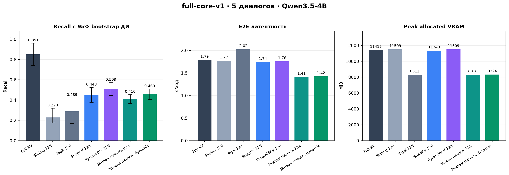
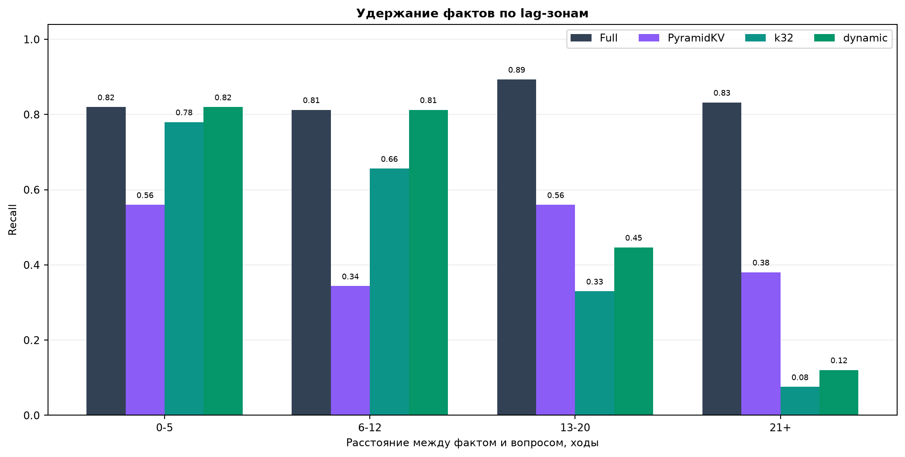
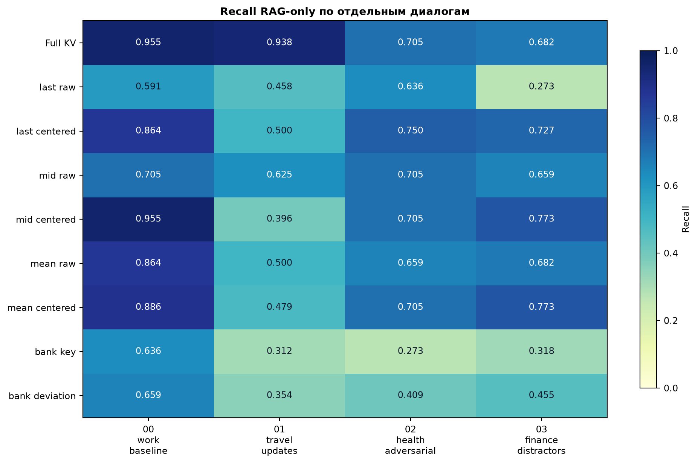
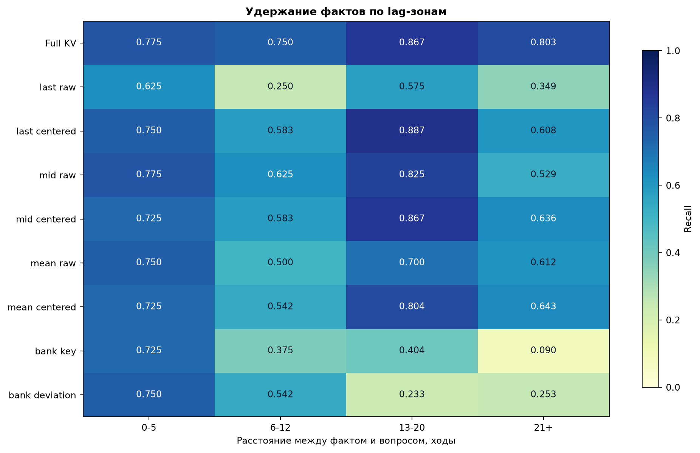
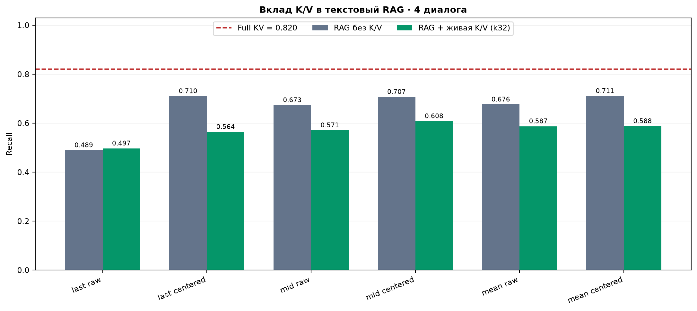

# Живая латентная память и текстовый retrieval в диалоговых LLM: компонентный анализ без дообучения

*Научная статья · экспериментальный срез: core 5/48, RAG 4/48 · 2026-11-20*

## АННОТАЦИЯ

Предложена training-free система живой диалоговой памяти: изменяемый банк скрытых состояний поддерживает EMA-слияние, TTL-забывание и динамическую подачу векторов в качестве дополнительных беспозиционных K/V в средние attention-слои замороженной модели. Система исследуется отдельно от текстового RAG и в сочетании с ним. На пяти main-диалогах Qwen3.5-4B динамическая инъекция получила recall 0,460 против 0,410 у фиксированной k32 (p=0,027 после Холма) и 0,509 у PyramidKV. Относительно PyramidKV она быстрее на 18,9% и использует на 27,7% меньше peak allocated VRAM, однако статистический паритет по качеству не установлен. На четырёх main-диалогах лучший чистый RAG достиг 0,711, тогда как лучший гибрид с фиксированной K/V-инъекцией — 0,608. Центрирование last-ключей улучшило RAG с 0,489 до 0,710 на всех четырёх диалогах. Таким образом, самостоятельный латентный канал демонстрирует работоспособность и ресурсные преимущества, но добавление K/V к текстовому retrieval может ухудшать качество. Работа одновременно описывает механизм, его сильные стороны и границы применимости; main-корпус остаётся незавершённым.

**Ключевые слова:** большие языковые модели; диалоговая память; retrieval-augmented generation; латентная память; K/V-инъекция; центрирование эмбеддингов; Qwen3.5

## Living Latent Memory and Text Retrieval in Dialogue LLMs: A Training-Free Component Analysis

**ABSTRACT**

We propose a training-free living-memory system for dialogue: a mutable bank of hidden states uses EMA merging, TTL-based forgetting, and dynamically gated injection as position-free K/V pairs into middle attention layers of a frozen model. The mechanism is evaluated alone and together with text RAG. On five main dialogues, dynamic injection obtains recall 0.460 versus 0.410 for fixed k32 (Holm-adjusted p=0.027) and 0.509 for PyramidKV. It reduces latency and peak allocated VRAM relative to PyramidKV, but statistical parity in quality is not established. On four main dialogues, the best RAG-only configuration reaches recall 0.711, whereas the best fixed-K/V hybrid reaches 0.608. Last-layer centering improves RAG from 0.489 to 0.710 on all four dialogues. The standalone latent channel is functional and resource-efficient, while adding K/V to text retrieval can harm quality. The report covers both strengths and weaknesses; the main corpus remains incomplete.

**Keywords:** large language models; dialogue memory; retrieval-augmented generation; latent memory; K/V injection; embedding centering; Qwen3.5

## ВВЕДЕНИЕ

Продолжительный диалог требует не только локальной связности, но и доступа к точным сведениям из далёкого прошлого. Полная история сохраняет исходные данные, однако увеличивает длину входа и KV-кэш. Сжатие кэша уменьшает число доступных состояний, но не восстанавливает удалённый факт. Текстовый retrieval возвращает дословные записи в промпт, тогда как латентная память способна влиять на вычисления без декодирования сохранённого состояния обратно в текст.

В работе исследуется живая память, понимаемая как изменяемый банк активаций замороженной модели. Запись сопровождается слиянием похожих состояний и забыванием; на каждом шаге текущее скрытое состояние определяет число подключаемых векторов. Выбранные активации проецируются собственными матрицами слоя в дополнительные ключи и значения attention. Текстовый канал при этом может быть отключён, что позволяет измерять самостоятельный механизм без RAG.

Цель — описать предложенную training-free конструкцию и установить, какие компоненты действительно отвечают за качество и стоимость. RQ1: как слой и центрирование влияют на текстовый retrieval? RQ2: насколько живая K/V-память работает без текстового канала и что меняет динамический гейт? RQ3: улучшает ли фиксированная K/V-инъекция соответствующий текстовый RAG? RQ4: какие сильные и слабые стороны воспроизводятся за пределами основного фактического теста?

Вклад состоит из трёх частей. Во-первых, предложена конкретная комбинация общего изменяемого банка скрытых состояний, TTL/EMA-динамики, динамической активации и multi-layer K/V-инъекции без обучения. Во-вторых, выполнены раздельные абляции текстового, латентного и гибридного каналов. В-третьих, приведены как положительные, так и отрицательные результаты, включая случаи, где ранний вывод не сохранился после добавления новых сценариев. Новизна отдельных общих принципов не утверждается: их связь с литературой явно рассматривается ниже.

## 1 ОБЗОР СУЩЕСТВУЮЩИХ РЕШЕНИЙ

1.1 Сжатие и выбор KV-состояний. StreamingLLM сохраняет attention sinks и недавние токены [1]; H2O оставляет heavy hitters по накопленному вниманию [2]. SnapKV отбирает состояния префикса по observation-окну [3], а PyramidKV дополнительно распределяет бюджет неравномерно между слоями [4]. Эти методы сравниваются численно в едином цикле декодирования. KIVI квантует K и V [5], а Quest выбирает релевантные страницы кэша во время attention [6]; оба метода остаются качественными аналогами, поскольку честное сравнение латентности требует соответствующих оптимизированных ядер.

1.2 Текстовая и агентная память. RAG возвращает найденные фрагменты внешнего источника во вход модели [7]. LongLLMLingua вместо этого сжимает уже имеющийся промпт с учётом вопроса [8]. MemGPT организует иерархию хранения и функции управления [9]; MemoryBank добавляет профиль пользователя и забывание [10]; A-MEM связывает и изменяет структурированные заметки [11]; Mem0 извлекает и консолидирует факты, включая графовое представление [12]. Наш текстовый банк проще этих систем и не выполняет отдельных LLM-вызовов для извлечения или редактирования фактов.

1.3 Латентная K/V-память. Memorizing Transformers сохраняют K/V прошлых сегментов во внешней пополняемой памяти и выполняют kNN-augmented attention [13]. Memory³ также использует явную память в форме разреженных attention K/V [30]. LongMem вводит residual side-network [14], RMT — memory-токены между сегментами [15], Landmark Attention — обучаемые якоря [16], Infini-attention — сжатое состояние и линейное attention [17]. Memory Layers используют разреженные обучаемые таблицы памяти [18, 19]. Эти работы показывают, что общий принцип латентной памяти и её подключения к attention не является новым.

M+ и MemoryLLM поддерживают самообновляемый латентный пул скрытых состояний [33], а MemDefrag консолидирует per-layer скрытые состояния и удаляет нерелевантные фрагменты [34]. Отличие нашей системы — не само существование памяти, а конкретная training-free связка: общий банк исходных средних активаций, TTL и EMA, динамический косинусный гейт и повторное использование замороженных $W_K/W_V$ сразу в нескольких full-attention слоях. Мы не утверждаем абсолютную новизну каждого компонента и рассматриваем новизну комбинации как кандидатную, а не исчерпывающе доказанную.

1.4 Геометрия эмбеддингов. Центрирование и удаление общих направлений являются известными приёмами борьбы с анизотропией представлений [31, 32]. Наш running centroid не следует позиционировать как новый алгоритм центрирования. Предмет эмпирического интереса — его роль как неявно обновляемой темы диалога и отличие этого бесплатного gist-эффекта от отдельного TTL-gist-банка.

1.5 Ограничения длинного контекста и гибридной модели. Даже доступный полный контекст не гарантирует одинакового использования сведений в разных позициях [20]. Qwen3.5 сочетает линейные и full-attention слои; связанные модели состояния включают Mamba и Gated DeltaNet [21, 22]. Поэтому выводы о слоях и инъекции нельзя автоматически переносить на чисто attention-архитектуры. Таблица 1 разделяет аналоги по уровню вмешательства и роли в настоящей работе.

**Таблица 1 — Существующие решения и аналоги**

| Метод | Принцип | Обучение | Роль в работе |
|---|---|---|---|
| Полный контекст | Вся история и полный KV-кэш | Нет | Верхний контроль |
| StreamingLLM | Attention sinks и недавние токены | Нет | [1]; численный контроль |
| H2O / TopK | Heavy hitters по накопленному вниманию | Нет | [2]; численный контроль |
| SnapKV | Отбор префикса по observation-окну | Нет | [3]; численный контроль |
| PyramidKV | Неравномерный бюджет по слоям | Нет | [4]; численный контроль |
| KIVI | Асимметричное 2-битное квантование K/V | Нет | [5]; качественный аналог |
| Quest | Query-aware выбор страниц KV-кэша | Нет | [6]; качественный аналог |
| RAG | Возврат текстовых фрагментов в промпт | Обычно нет | [7]; отдельный канал |
| LongLLMLingua | Question-aware сжатие промпта | Нет для backbone | [8]; качественный аналог |
| MemGPT | Иерархия памяти и функции управления | Не обязательно | [9]; системный аналог |
| MemoryBank | Поиск, профиль и забывание | Не обязательно | [10]; системный аналог |
| A-MEM | Связные заметки и эволюция памяти | Не обязательно | [11]; системный аналог |
| Mem0 | Извлечение, консолидация и граф | Не обязательно | [12]; системный аналог |
| Memorizing Transformers | kNN-поиск по K/V прошлых сегментов | Да | [13]; близкий архитектурный аналог |
| Memory³ | Явная внешняя память из sparse K/V | Да | [30]; близкий архитектурный аналог |
| LongMem | Поиск и residual side-network | Да | [14]; архитектурный аналог |
| RMT | Memory-токены между сегментами | Да | [15]; архитектурный аналог |
| Landmark Attention | Обучаемые якоря блоков | Да | [16]; архитектурный аналог |
| Infini-attention | Локальное attention и сжатое состояние | Да | [17]; архитектурный аналог |
| Memory Layers | Разреженные обучаемые таблицы памяти | Да | [18, 19]; архитектурный аналог |
| M+ / MemoryLLM | Самообновляемый латентный пул | Да | [33]; аналог скрытых состояний |
| MemDefrag | Консолидация и забывание latent-памяти | Зависит от backbone | [34]; аналог динамики памяти |
| Живая память | TTL/EMA-банк + динамическая K/V-инъекция | Нет | Предложенный вариант |

## 2 МАТЕРИАЛЫ И МЕТОДЫ

2.1 Общая архитектура. Система содержит независимые текстовый и латентный каналы. Текстовый банк хранит дословные пользовательские реплики и их эмбеддинги. Латентный банк хранит скрытые состояния средних full-attention слоёв. В режиме RAG-only активен только первый канал; в inject-only — только второй; в двухканальном режиме оба действуют одновременно. Веса базовой модели не изменяются.

2.2 Эмбеддинги текстового банка. Для реплики $x$ длиной $T$ токенов извлекаются скрытые состояния $h_i^{(l)}$ выбранного слоя и усредняются по позициям: $e_l(x)=T^{-1}\sum_{i=1}^{T}h_i^{(l)}$. Вариант last использует финальный слой, mid — один средний слой, mean — сначала среднее всех слоёв кроме embedding, затем среднее по токенам. Реплика кодируется изолированно, не более 128 токенов; отдельный энкодер не используется.

Raw-контроль нормализует исходный эмбеддинг. Centered-вариант вычитает running mean ранее принятых реплик и затем выполняет $L_2$-нормирование. Запись фиксируется по среднему, ещё не содержащему саму новую реплику, и позднее не пересчитывается:

$$
c_t=\frac{1}{t}\sum_{j=1}^{t}e_j,\qquad u_j=\frac{e_j-c_{j-1}}{\Vert e_j-c_{j-1}\Vert_2},\qquad c_0=0, \tag{1}
$$

где $t$ — число принятых реплик; $e_j$ — эмбеддинг $j$-й записи; $c_t$ — бегущее среднее; $u_j$ — сохранённый нормированный ключ. Среднее включает позднее заменённые и вытесненные записи. Запрос центрируется текущим средним. Поскольку запрос и записи имеют единичную норму, косинусная близость сводится к скалярному произведению:

$$
\operatorname{sim}(u,q)=\frac{u\cdot q}{\Vert u\Vert_2\,\Vert q\Vert_2}, \tag{2}
$$

где $u$ и $q$ — ключ записи и запрос. В промпт возвращаются тексты top-4 записей. Реплики, оканчивающиеся на «?», не записываются; эта эвристика не распознаёт все вопросы. При сходстве не менее 0,95 выполняется upsert, при переполнении банка на 256 записей вытесняется старейшая запись.

2.3 Живой банк активаций. Банк содержит 512 слотов и является общим для инструментированных слоёв. Новый вектор сливается с ближайшим занятым слотом при косинусной близости не менее 0,95; занимает свободный слот при близости к ближайшему не более 0,4 и прохождении гейта активности; иначе отбрасывается. Слияние выполняется экспоненциальным скользящим средним:

$$
a_j\leftarrow\lambda a_j+(1-\lambda)h,\qquad \lambda=0{,}75, \tag{3}
$$

где $a_j$ — хранимый вектор; $h$ — новое скрытое состояние. Новый слот получает TTL 5; извлечение увеличивает TTL на 2 до потолка 6, слияние поднимает его как минимум до 5, а каждый вызов инструментированного слоя уменьшает TTL на 1. Слот с неположительным TTL вытесняется. Гейт активности требует, чтобы сумма хотя бы одного неперекрывающегося 32-мерного блока превышала 0,5.

2.4 Динамический отбор. Сначала CorrectionLayer возвращает до 256 кандидатов по максимальной косинусной близости слота к токенам текущего скрытого состояния. Для динамической конфигурации дополнительно вычисляется близость каждого кандидата $a_j$ к среднему текущему состоянию $\bar h_t$. Если кандидаты упорядочены исходным retrieval, их число после гейта равно

$$
n_t=\min\!\left(k_{\max},\sum_{j=1}^{m_t}\mathbb{1}\!\left[\cos(a_j,\bar h_t)\geq\tau\right]\right),\qquad \tau=0{,}5,\quad k_{\max}=32, \tag{4}
$$

где $m_t$ — число кандидатов; $n_t$ — число инжектируемых векторов. В attention подаются первые $n_t$ векторов этого упорядоченного списка. Допускается $n_t=0$. Фиксированный k32 вместо этого использует $n_t=\min(m_t,32)$ независимо от второго косинусного гейта.

2.5 K/V-инъекция. Если $A_t$ содержит $n_t$ выбранных активаций размерности 2560, дополнительные ключи и значения вычисляются проекциями текущего слоя и конкатенируются с реальными состояниями:

$$
K_m=R_K(W_KA_t),\qquad V_m=W_VA_t,\qquad \widetilde K=[K;K_m],\qquad \widetilde V=[V;V_m], \tag{5}
$$

где $R_K$ — QK-Norm слоя; $W_K,W_V$ — замороженные проекции. RoPE к памяти не применяется. Расширенное attention записывается как

$$
O=\operatorname{softmax}\!\left(\frac{Q\widetilde K^{\top}}{\sqrt{d_k}}+B\right)\widetilde V, \tag{6}
$$

где $B$ — аддитивная маска, дополненная нулевыми столбцами памяти. Причинная маска реальных токенов сохраняется, включая multi-token prefill. Память видима всем реальным токенам, но не попадает в последовательный KV-кэш. Инъекция выполняется в слои 11, 15, 19 и 23 — среднюю половину восьми full-attention слоёв Qwen3.5-4B. Группировка query/KV-голов, сигмоидный гейт и выходная проекция $W_O$ остаются базовыми.

2.6 Порядок работы. Текстовый retrieval выполняется до добавления текущей реплики в банк; найденные заметки объединяются с последними десятью парами «пользователь—ответ». Во время prefill и decoding латентный банк пополняется и одновременно предоставляет выбранные K/V. Поскольку вычисление эмбеддингов также проходит через инструментированные слои, гибрид способен влиять на собственные будущие ключи. Эта самоиндукция рассматривается как возможный источник негативного взаимодействия, но не считается доказанной причиной без отдельного механистического теста.

2.7 Центроид как неявный gist. Running mean текстового банка меняется с историей, поэтому centered запрос представляет отклонение текущей реплики от накопленной темы. Это отличается от явного TTL-взвешенного gist, прибавляемого к запросу. Первый механизм встроен в центрирование; второй тестируется отдельно и не должен смешиваться с ним при интерпретации результатов.

2.8 Модель и вычислительная среда. Используется Qwen/Qwen3.5-4B bf16 [29]: 32 слоя, скрытая размерность 2560, 16 query-голов и 4 KV-головы, 8 full-attention слоёв. Вычисления выполнены на AMD RX 7900 XT с 20 GiB VRAM, PyTorch 2.9.1+ROCm 6.3. Генерация greedy, до 32 новых токенов.


Рисунок 1 — Независимые текстовый и латентный каналы

## 3 ЭКСПЕРИМЕНТАЛЬНАЯ УСТАНОВКА

3.1 Серии экспериментов. Основные выводы опираются на post-fix серии latent-v1, full-core-v1 и full-rag-v1. Более ранний battery100 используется только как исторический предварительный тест: до исправления маски латентный канал был инертен в multi-token prefill. Поэтому его прежнее преимущество двухканальной системы не рассматривается как актуальное доказательство. Состав серий приведён в таблице 2.

3.2 Main-корпус. Полный main содержит 48 диалогов: 24 комбинации темы, персоны и сценария на длинах 100 и 200 ходов. Текущий срез core включает пять первых 100-ходовых диалогов; RAG — четыре. Каждый диалог содержит факты, прямые и переформулированные вопросы, multi-hop, temporal и unanswerable-пробы в lag-зонах 0–5, 6–12, 13–20 и 21+. Сценарии включают baseline, updates, adversarial, distractors и multifact. Тема, персона и сценарий меняются совместно, поэтому срезы не являются независимыми факториальными условиями.

3.3 Сравниваемые конфигурации. Core сравнивает Full KV, Sliding, TopK, SnapKV, PyramidKV при среднем бюджете 128, фиксированную живую память k32 и dynamic. RAG-набор содержит полную матрицу слоёв last/mid/mean × raw/centered × RAG-only/+K/V, а также bank key и bank deviation. Гибриды используют фиксированные k32; dynamic в них не применяется. Параметры приведены в таблице 3.

3.4 Протокол латентности. Каждый main-батч выполняет один warmup и пять повторов с ротацией порядка стратегий. End-to-end время включает prefill, decoding, retrieval и embedding. Отдельно сохраняются prompt/generated/embed-токены, максимальная длина кэша и torch.max_memory_allocated. Последняя метрика не включает всю reserved-память долгоживущего процесса. Старый battery100 измерял более узкий путь генерации и поэтому не смешивается с main-латентностью.

3.5 Метрики качества. Keyword recall равен доле ожидаемых строк, найденных в ответе без учёта регистра:

$$
R=\frac{1}{N}\sum_{i=1}^{N}\mathbb{1}\!\left[\exists k\in y_i:\ \operatorname{contains}(\operatorname{lower}(a_i),k)\right], \tag{7}
$$

где $N$ — число проб; $y_i$ — допустимые ключевые строки; $a_i$ — ответ. Multi-hop допускает частичный балл 0,5. Answerable-only исключает unanswerable-пробы. Исходная unanswerable-метрика завышена: отсутствие forbidden-строки не всегда означает настоящий отказ. Для обновлений основной показатель — stale_updated_rate, поскольку простое упоминание старого значения не обязательно является ошибкой.

Дополнительные диагностики включают tone как косинус к репликам банка и repetition rate по словесным триграммам:

$$
D=1-\frac{U}{G}, \tag{8}
$$

где $G$ — общее число триграмм; $U$ — число уникальных. Обе метрики не заменяют человеческую оценку связности или естественности диалога.

3.6 Метрики attention и статистика. Decode-side attention-прокси суммирует среднюю длину кэша по $L$ full-attention слоям на $S$ шагах:

$$
A=\sum_{s=1}^{S}\frac{1}{L}\sum_{l=1}^{L}\left|K_{l,s}\right|,\qquad E_A=\frac{A_{\mathrm{full}}}{A_{\mathrm{method}}}, \tag{9}
$$

где $A$ не является прямым замером FLOPs и не описывает квадратичную стоимость prefill. Основные статистические выводы используют диалог, а не вопрос, как единицу анализа. Доверительные интервалы получены percentile bootstrap; парные сравнения — paired bootstrap по общим batch_id с поправкой Холма внутри заранее определённого семейства сравнений. Незначимая разница при малом $n$ не интерпретируется как доказанная эквивалентность.

**Таблица 2 — Экспериментальные серии**

| Серия | Диалоги | Назначение | Валидность |
|---|---|---|---|
| battery100 | 1 × 107 ходов | Предварительное сравнение 7 систем | pre-fix; только исторический контекст |
| latent-v1 | 4/12 × 100 ходов | Mid-RAG, RAG±K/V, inject-only | post-fix; пилот |
| full-core-v1 | 5/48 × 100 ходов | Конкуренты и k32 vs dynamic | post-fix; основной срез |
| full-rag-v1 | 4/48 × 100 ходов | Last/mid/mean × raw/centered × ±K/V | post-fix; основной срез |
| Специальные тесты | Малые серии | TTL/gist, цель, нити, слепая оценка | Диагностические; разные протоколы |

**Таблица 3 — Параметры сравниваемых систем**

| Система | Контекст | Память и параметры |
|---|---|---|
| Full KV | Вся история | Неограниченный классический KV-кэш |
| Sliding / TopK | Вся история | 128 слотов; 4 sink + recent/heavy hitters |
| SnapKV | Вся история | 128; observation=64; kernel=7 |
| PyramidKV | Вся история | Среднее 128; observation=8; β=20 |
| RAG-only | 10 последних пар + top-4 | Last/mid/mean; raw/centered; банк 256 |
| Inject-only k32 | 10 последних пар | Банк 512; до 32 K/V в 4 слоях; без текста |
| Inject-only dynamic | 10 последних пар | Косинусный гейт 0,5; 0–32 K/V; без текста |
| RAG + K/V | 10 последних пар + top-4 | Текстовый канал + фиксированная k32 |

## 4 РЕЗУЛЬТАТЫ

4.1 Живая память без текстового RAG. На пяти core-диалогах dynamic получил recall 0,460, k32 — 0,410, PyramidKV — 0,509, SnapKV — 0,448, Full KV — 0,851. Dynamic лучше k32 после поправки Холма (p=0,027), тогда как различия с PyramidKV и SnapKV не значимы. При этом численный средний recall PyramidKV выше; поэтому нельзя утверждать ни превосходство, ни доказанный паритет dynamic с ним.

Dynamic подключает в среднем 2,52 слота/шаг против 31,92 у k32. Относительно PyramidKV его E2E ниже на 18,9%, средний peak allocated VRAM ниже на 27,7%, prompt-объём меньше в 4,96 раза. Attention-прокси, напротив, выше примерно в 3,26 раза: ресурсное преимущество относится к измеренным латентности, памяти и входу, но не ко всем вычислительным осям. Результаты приведены в таблице 4 и на рисунках 2–4.

4.2 Текстовый RAG без инъекций. Лучшие конфигурации — mean centered (0,711), last centered (0,710) и mid centered (0,707). Их доверительные интервалы перекрываются; однозначного победителя нет. Bank key и bank deviation получают лишь 0,385 и 0,469.

Центрирование last увеличивает recall с 0,489 до 0,710; сдвиг положителен на всех четырёх диалогах, p<0,001 после Холма. Для mid и mean приросты составляют около +0,034 и не значимы (p=0,668 и 0,126). Raw mid/mean сильнее raw last, но после центрирования различия между слоями почти исчезают. Полные данные даны в таблице 5 и на рисунках 5–8.

4.3 Добавление K/V к RAG. На текущих четырёх диалогах лучший гибрид — v4_rag_kv_mid с recall 0,608, что ниже лучших чистых RAG. Средний сдвиг по шести парам варьируется от +0,007 до −0,146, а E2E увеличивается примерно на 12–14%. Значимое после Холма ухудшение получено у last centered (Δ=−0,146, p=0,042); остальные пары не показывают значимого преимущества. Отрицательные сдвиги сохраняются и без unanswerable-проб. Парные данные приведены в таблице 6 и на рисунке 9.

Ранний срез из двух диалогов показывал противоположную картину: raw mid/mean-гибриды лидировали. Добавление health/adversarial и особенно finance/distractors отменило этот вывод. На finance все шесть гибридов хуже соответствующих чистых каналов. Это демонстрирует сценарную зависимость и опасность формирования научного вывода по первым благоприятным диалогам.

4.4 Пилотные серии и перенос слоя. В post-fix latent-v1 на четырёх pilot-диалогах rag_latent_mid получил 0,851 против 0,775 у raw last, а inject-only k32 и PyramidKV имели практически одинаковый recall 0,533 и 0,532. Это раннее доказательство ресурсного компромисса живой памяти согласуется с core, но не отменяет более позднего численного отставания dynamic от PyramidKV на main. Преимущество mid-ключей также не универсально: на thread_coherence last был лучше mid. Поэтому выбор слоя остаётся задачно-зависимым.

4.5 Дополнительные механизмы. Явный TTL-gist, merge-цель и K/V-контекстуализация не дали робастного преимущества в специализированных тестах. На thread_coherence чистый centered RAG имел confusion 0,000 против 0,286 у K/V после исправления маски. В goal_dialogue merge ухудшил confusion, в interlocutor метрика оказалась насыщена, а слепая оценка не выявила консенсуса о преимуществе живой памяти. Эти результаты не имеют статистической мощности основного corpus и используются как диагностические, а не как самостоятельные доказательства общего null-эффекта. Сводка дана в таблице 7.

**Таблица 4 — Живая память и конкуренты на core**

| Система | Recall [95% ДИ] | Answerable | E2E, с/ход | Peak MiB | Prompt |
|---|---|---|---|---|---|
| Чистый Qwen: полный контекст + KV | 0.851 [0.741; 0.961] | 0.836 | 1.787 | 11415 | 218052 |
| StreamingLLM | 0.229 [0.176; 0.320] | 0.153 | 1.775 | 11509 | 220435 |
| H2O | 0.289 [0.169; 0.423] | 0.220 | 2.025 | 8311 | 222188 |
| SnapKV | 0.448 [0.378; 0.525] | 0.394 | 1.740 | 11349 | 218397 |
| PyramidKV | 0.509 [0.446; 0.573] | 0.461 | 1.758 | 11509 | 221525 |
| Живая память k32 | 0.410 [0.368; 0.454] | 0.352 | 1.411 | 8318 | 44621 |
| Живая память dynamic | 0.460 [0.405; 0.509] | 0.406 | 1.425 | 8324 | 44623 |


Рисунок 2 — Core: качество, E2E и peak allocated VRAM


Рисунок 3 — Core: recall по отдельным диалогам


Рисунок 4 — Core: удержание по lag-зонам

**Таблица 5 — Текстовый RAG без K/V-инъекций**

| Система | Recall [95% ДИ] | Answerable | E2E, с/ход | Peak MiB | Prompt |
|---|---|---|---|---|---|
| Full KV | 0.820 [0.694; 0.947] | 0.802 | 1.810 | 11581 | 223115 |
| rag_text_only | 0.489 [0.352; 0.614] | 0.451 | 1.285 | 8370 | 50011 |
| rag_last_centered | 0.710 [0.562; 0.830] | 0.682 | 1.254 | 8371 | 49673 |
| rag_latent_mid | 0.673 [0.642; 0.705] | 0.641 | 1.266 | 8372 | 49848 |
| rag_mid_centered | 0.707 [0.490; 0.892] | 0.690 | 1.261 | 8371 | 49466 |
| rag_mean | 0.676 [0.545; 0.813] | 0.645 | 1.265 | 8360 | 49540 |
| rag_mean_centered | 0.711 [0.552; 0.841] | 0.683 | 1.257 | 8348 | 49610 |
| rag_bank_key | 0.385 [0.284; 0.555] | 0.325 | 1.276 | 8347 | 48145 |
| rag_bank_dev | 0.469 [0.379; 0.597] | 0.418 | 1.275 | 8341 | 49335 |


Рисунок 5 — RAG-only: качество и стоимость


Рисунок 6 — Парный эффект центрирования


Рисунок 7 — RAG-only по диалогам


Рисунок 8 — RAG-only по lag-зонам

**Таблица 6 — Вклад фиксированной K/V-инъекции в RAG**

| Канал | RAG-only | +K/V | Δ recall | p Холма | Δ E2E |
|---|---|---|---|---|---|
| last raw | 0.489 | 0.497 | +0.007 | 1.0000 | +11.9% |
| last centered | 0.710 | 0.564 | -0.146 | 0.0420 | +14.3% |
| mid raw | 0.673 | 0.571 | -0.102 | 1.0000 | +12.3% |
| mid centered | 0.707 | 0.608 | -0.099 | 1.0000 | +14.3% |
| mean raw | 0.676 | 0.587 | -0.089 | 1.0000 | +13.7% |
| mean centered | 0.711 | 0.588 | -0.123 | 0.4225 | +14.1% |


Рисунок 9 — Сравнение шести пар RAG-only и RAG+K/V

**Таблица 7 — Дополнительные механистические тесты**

| Тест | Условие | Наблюдение | Ограничение |
|---|---|---|---|
| goal_dialogue | Merge-цель vs чистый centered RAG | Confusion 0,600 vs 0,400 | Специальный малый тест |
| interlocutor | Gist vs plain RAG | 0,756 vs 0,760; метрика насыщена | Низкая чувствительность |
| thread_coherence | K/V после фикса маски | Confusion 0,286 vs 0,000 у v3 | 7 проб; другой протокол |
| blind_eval | Слепая оценка 5 условий | Нет консенсуса о преимуществе | Субъективная оценка |
| living_memory | Явный TTL-gist поверх центрирования | Дополнительного выигрыша нет | Отличать от running centroid |

## 5 ОБСУЖДЕНИЕ

5.1 Сильные стороны самостоятельной живой памяти. Механизм работает без текстового retrieval и без обучения, а dynamic улучшает фиксированную k32 при более чем десятикратном сокращении среднего числа инъекций. По сравнению с PyramidKV он уменьшает измеренную латентность, allocated VRAM и prompt-объём. Это делает самостоятельный канал содержательным направлением, несмотря на то что его recall остаётся ниже полного контекста и не превосходит PyramidKV по текущему среднему.

5.2 Слабые стороны гибрида. Добавление тех же латентных состояний к текстовому RAG не эквивалентно суммированию их полезности. На distractors гибрид особенно слаб, а centered last теряет качество статистически значимо. Возможные причины включают конкуренцию текстовых и латентных сигналов, лишние инъекции и самоискажение ключей при prefill. Настоящие данные различают эффект по сценариям, но не позволяют выбрать одну причину. Динамический гейт в гибридах ещё не тестировался, поэтому перенос отрицательного результата k32 на dynamic-гибрид не допускается.

5.3 Что работает в текстовом канале. Наиболее убедительный компонентный результат — last centering относительно собственного raw-контроля. Running centroid можно интерпретировать как обновляемую тему, относительно которой запрос и записи кодируются отклонением. Явный TTL-gist при этом не нужен или вредит в проведённых тестах. Однако центрирование само по себе известно; вкладом является его эмпирическое разделение с K/V и gist-компонентами в конкретной диалоговой системе.

5.4 Новизна и связь с аналогами. Нельзя заявлять новизну общего принципа «латентная память + инъекция в attention»: он представлен в Memorizing Transformers, Memory³, MemoryLLM/M+ и других работах. Вместе с тем эти системы не воспроизводят дословно нашу training-free конфигурацию с общим TTL/EMA-банком исходных скрытых состояний, динамическим активационным гейтом и frozen проекциями в нескольких средних слоях. Мы представляем её как предложенный новый вариант, а не как доказанное первое появление всего класса. Научная ценность результата дополнительно состоит в проверке того, где этот вариант помогает и где ухудшает систему.

5.5 Угрозы валидности. Main-корпус не завершён: core содержит 5/48, RAG — 4/48 диалогов, все длиной 100 ходов. Малое $n$ ограничивает мощность парных тестов; percentile bootstrap на таком срезе имеет дискретное и потенциально оптимистичное покрытие. Сценарий конфаундирован темой, персоной и seed. Keyword recall измеряет восстановление заданных строк, а не всё качество ответа; unanswerable-метрика завышена. Политики KV реализованы в проекте по публикациям, а не взяты из официальных оптимизированных реализаций [23–28]. Наконец, выводы получены на одной гибридной Qwen3.5-4B и одной GPU-конфигурации.

5.6 Следующие эксперименты. Приоритетно завершение общих main-диалогов core и RAG, включая 200-ходовые. Для гибрида требуется отдельная dynamic-версия и механистический тест самоискажения банка. Для живой памяти важны temporal-пробы и дальние lag-зоны: текущий temporal recall k32 и dynamic равен нулю. Сравнение с KIVI/Quest требует оптимизированных ядер, а выводы на других моделях и языках должны быть проверены независимо.

## ЗАКЛЮЧЕНИЕ

Предложена и реализована training-free живая память с изменяемым банком скрытых состояний, TTL/EMA-динамикой и динамической K/V-инъекцией в средние attention-слои. Её отличие от известных классов латентной памяти описано без приписывания новизны общему принципу инъекции.

Без текстового RAG dynamic получил recall 0,460 и превзошёл k32 (0,410, p=0,027 после Холма), сократив среднее число инъекций с 31,92 до 2,52. Относительно PyramidKV он быстрее и легче по измеренным ресурсам, но его качество пока численно ниже (0,509 у PyramidKV), а паритет не доказан.

Текстовый centered RAG достиг 0,711; last centering дал наиболее устойчивый внутренний эффект. В гибридах фиксированная K/V-инъекция общего преимущества не показала и в среднем ухудшала качество. Таким образом, сильная сторона работы — работоспособный и ресурсно-эффективный самостоятельный латентный канал, а слабая — его текущее взаимодействие с текстовым retrieval и temporal-удержанием. Завершение полного корпуса необходимо для окончательной оценки.

## ДОСТУПНОСТЬ ДАННЫХ И ВОСПРОИЗВОДИМОСТЬ

Первичные результаты сохранены в results/corpus/full-core-v1/batches/ и results/corpus/full-rag-v1/batches/. Промежуточные отчёты автоматически пересчитываются из манифестов и JSON. Исторический battery100 находится в results/qwen35_comparison/qwen35-4b_battery100.json и помечен как pre-fix. Текст статьи генерируется scripts/paper_text.py; таблицы, рисунки и PDF — scripts/report_data.py, scripts/paper_figures.py и scripts/build_paper.py. Проверка статьи против кода и архивов выполняется scripts/verify_paper.py.

## СПИСОК ЛИТЕРАТУРЫ

1. Xiao G. Efficient Streaming Language Models with Attention Sinks / G. Xiao, Y. Tian, B. Chen, S. Han, M. Lewis // ICLR. — 2024. — URL: https://arxiv.org/abs/2309.17453 (дата обращения: 20.11.2026).
2. Zhang Z. H2O: Heavy-Hitter Oracle for Efficient Generative Inference of Large Language Models / Z. Zhang et al. // NeurIPS. — 2023. — URL: https://arxiv.org/abs/2306.14048 (дата обращения: 20.11.2026).
3. Li Y. SnapKV: LLM Knows What You are Looking for Before Generation / Y. Li et al. // NeurIPS. — 2024. — URL: https://arxiv.org/abs/2404.14469 (дата обращения: 20.11.2026).
4. Cai Z. PyramidKV: Dynamic KV Cache Compression based on Pyramidal Information Funneling / Z. Cai et al. — 2024. — URL: https://arxiv.org/abs/2406.02069 (дата обращения: 20.11.2026).
5. Liu Z. KIVI: A Tuning-Free Asymmetric 2bit Quantization for KV Cache / Z. Liu et al. // ICML. — 2024. — URL: https://arxiv.org/abs/2402.02750 (дата обращения: 20.11.2026).
6. Tang J. Quest: Query-Aware Sparsity for Efficient Long-Context LLM Inference / J. Tang et al. // ICML. — 2024. — URL: https://arxiv.org/abs/2406.10774 (дата обращения: 20.11.2026).
7. Lewis P. Retrieval-Augmented Generation for Knowledge-Intensive NLP Tasks / P. Lewis et al. // NeurIPS. — 2020. — URL: https://arxiv.org/abs/2005.11401 (дата обращения: 20.11.2026).
8. Jiang H. LongLLMLingua: Accelerating and Enhancing LLMs in Long Context Scenarios via Prompt Compression / H. Jiang et al. // ACL. — 2024. — URL: https://arxiv.org/abs/2310.06839 (дата обращения: 20.11.2026).
9. Packer C. MemGPT: Towards LLMs as Operating Systems / C. Packer et al. — 2023. — URL: https://arxiv.org/abs/2310.08560 (дата обращения: 20.11.2026).
10. Zhong W. MemoryBank: Enhancing Large Language Models with Long-Term Memory / W. Zhong et al. — 2023. — URL: https://arxiv.org/abs/2305.10250 (дата обращения: 20.11.2026).
11. Xu W. A-MEM: Agentic Memory for LLM Agents / W. Xu et al. // NeurIPS. — 2025. — URL: https://arxiv.org/abs/2502.12110 (дата обращения: 20.11.2026).
12. Chhikara P. Mem0: Building Production-Ready AI Agents with Scalable Long-Term Memory / P. Chhikara et al. — 2025. — URL: https://arxiv.org/abs/2504.19413 (дата обращения: 20.11.2026).
13. Wu Y. Memorizing Transformers / Y. Wu et al. // ICLR. — 2022. — URL: https://arxiv.org/abs/2203.08913 (дата обращения: 20.11.2026).
14. Wang W. Augmenting Language Models with Long-Term Memory / W. Wang et al. — 2023. — URL: https://arxiv.org/abs/2306.07174 (дата обращения: 20.11.2026).
15. Bulatov A. Recurrent Memory Transformer / A. Bulatov, Y. Kuratov, M. Burtsev // NeurIPS. — 2022. — URL: https://arxiv.org/abs/2207.06881 (дата обращения: 20.11.2026).
16. Mohtashami A. Landmark Attention: Random-Access Infinite Context Length for Transformers / A. Mohtashami, M. Jaggi // NeurIPS. — 2023. — URL: https://arxiv.org/abs/2305.16300 (дата обращения: 20.11.2026).
17. Munkhdalai T. Leave No Context Behind: Efficient Infinite Context Transformers with Infini-attention / T. Munkhdalai, M. Faruqui, S. Gopal. — 2024. — URL: https://arxiv.org/abs/2404.07143 (дата обращения: 20.11.2026).
18. Berges V.-P. Memory Layers at Scale / V.-P. Berges et al. — 2024. — URL: https://arxiv.org/abs/2412.09764 (дата обращения: 20.11.2026).
19. Lample G. Large Memory Layers with Product Keys / G. Lample et al. // NeurIPS. — 2019. — URL: https://arxiv.org/abs/1907.05242 (дата обращения: 20.11.2026).
20. Liu N. F. Lost in the Middle: How Language Models Use Long Contexts / N. F. Liu et al. // TACL. — 2024. — URL: https://arxiv.org/abs/2307.03172 (дата обращения: 20.11.2026).
21. Gu A. Mamba: Linear-Time Sequence Modeling with Selective State Spaces / A. Gu, T. Dao. — 2023. — URL: https://arxiv.org/abs/2312.00752 (дата обращения: 20.11.2026).
22. Yang S. Gated Delta Networks: Improving Mamba2 with Delta Rule / S. Yang et al. // ICLR. — 2025. — URL: https://arxiv.org/abs/2412.06464 (дата обращения: 20.11.2026).
23. StreamingLLM: official implementation [Электронный ресурс] // GitHub. — URL: https://github.com/mit-han-lab/streaming-llm (дата обращения: 20.11.2026).
24. H2O: official implementation [Электронный ресурс] // GitHub. — URL: https://github.com/FMInference/H2O (дата обращения: 20.11.2026).
25. SnapKV: official implementation [Электронный ресурс] // GitHub. — URL: https://github.com/FasterDecoding/SnapKV (дата обращения: 20.11.2026).
26. KVCache-Factory: official implementation of PyramidKV [Электронный ресурс] // GitHub. — URL: https://github.com/Zefan-Cai/KVCache-Factory (дата обращения: 20.11.2026).
27. KIVI: official implementation [Электронный ресурс] // GitHub. — URL: https://github.com/jy-yuan/KIVI (дата обращения: 20.11.2026).
28. Quest: official implementation [Электронный ресурс] // GitHub. — URL: https://github.com/mit-han-lab/Quest (дата обращения: 20.11.2026).
29. Qwen3.5-4B: model card [Электронный ресурс] // Hugging Face. — URL: https://huggingface.co/Qwen/Qwen3.5-4B (дата обращения: 20.11.2026).
30. Yang W. Memory3: Language Modeling with Explicit Memory / W. Yang et al. — 2024. — URL: https://arxiv.org/abs/2407.01178 (дата обращения: 20.11.2026).
31. Mu J. All-but-the-Top: Simple and Effective Postprocessing for Word Representations / J. Mu, P. Viswanath // ICLR. — 2018. — URL: https://arxiv.org/abs/1702.01417 (дата обращения: 20.11.2026).
32. Ethayarajh K. How Contextual are Contextualized Word Representations? Comparing the Geometry of BERT, ELMo, and GPT-2 Embeddings / K. Ethayarajh // EMNLP. — 2019. — URL: https://aclanthology.org/D19-1006 (дата обращения: 20.11.2026).
33. Wang Y. M+: Extending MemoryLLM with Scalable Long-Term Memory / Y. Wang et al. // ICML. — 2025. — URL: https://proceedings.mlr.press/v267/wang25au.html (дата обращения: 20.11.2026).
34. Yan R. MemDefrag: Latent Memory Defragmentation for Large Language Models / R. Yan, Z. Mao, Y. Guo. — 2026. — URL: https://arxiv.org/abs/2607.05969 (дата обращения: 20.11.2026).

## ВОСПРОИЗВЕДЕНИЕ

```bash
scripts/run_dialogue_fullscale.sh core night
scripts/run_dialogue_fullscale.sh rag night
.venv/bin/python scripts/build_core_report.py
.venv/bin/python scripts/build_rag_only_report.py
.venv/bin/python scripts/build_paper.py
.venv/bin/python scripts/verify_paper.py
```
